# Especificación de Requerimientos de Software (SRS) v1.0 — Núcleo SaaS Transversal (`NUC`)

| Atributo | Valor |
|----------|-------|
| **Código de documento** | `SRS-NUC-01` |
| **Versión** | `1.0` |
| **Fecha** | 2026-11-25 |
| **Issue asociada** | `FIN-04` (`FIN-4`) |
| **Estado** | Aprobado para diseño de detalle y desarrollo (sujeto a confirmaciones acotadas en Apéndice D) |
| **Estándar de referencia** | Adaptado de IEEE Std 830 / ISO/IEC/IEEE 29148 |
| **Ámbito** | Capa 1 (Núcleo SaaS Transversal siempre activo) y contratos de extensión con Capas 2 a 5 |
| **Fuentes consolidadas** | [Análisis general](../01-analisis-negocio/00-README.md), [Arquitectura general](../04-arquitectura/README.md), [Cierre Ronda 2 piloto](../../clientes/cliente-piloto/05-cuestionario-ronda2-cierre.md) y Guía del núcleo (v0.1) |

---

## Tabla de contenido

- [1. Introducción](#1-introducción)
- [2. Descripción General](#2-descripción-general)
- [3. Requerimientos Específicos](#3-requerimientos-específicos)
  - [3.1 Interfaces Externas e Internas (Puntos de Extensión)](#31-interfaces-externas-e-internas-puntos-de-extensión)
  - [3.2 Requerimientos Funcionales por Contexto (`K1` a `K9`)](#32-requerimientos-funcionales-por-contexto-k1-a-k9)
  - [3.3 Requerimientos No Funcionales (`NUC-RNF-01` a `NUC-RNF-23`)](#33-requerimientos-no-funcionales-nuc-rnf-01-a-nuc-rnf-23)
  - [3.4 Restricciones de Diseño y Reglas Arquitectónicas](#34-restricciones-de-diseño-y-reglas-arquitectónicas)
  - [3.5 Atributos Lógicos de Datos y Cumplimiento de Privacidad](#35-atributos-lógicos-de-datos-y-cumplimiento-de-privacidad)
- [Apéndice A. Modelo de Dominio Conceptual, Decisiones, Reglas, Invariantes y Glosario](#apéndice-a-modelo-de-dominio-conceptual-decisiones-reglas-invariantes-y-glosario)
- [Apéndice B. Matriz de Trazabilidad](#apéndice-b-matriz-de-trazabilidad)
- [Apéndice C. Escenarios de Validación y Criterios de Aceptación](#apéndice-c-escenarios-de-validación-y-criterios-de-aceptación)
- [Apéndice D. Resolución de Inconsistencias (§15 de la Guía) y Temas Pendientes Acotados](#apéndice-d-resolución-de-inconsistencias-15-de-la-guía-y-temas-pendientes-acotados)

---

## 1. Introducción

### 1.1 Propósito

Este documento establece la especificación normativa **v1.0** de los requerimientos funcionales, no funcionales, interfaces externas, contratos de extensión, invariantes de integridad y restricciones de diseño del **Núcleo SaaS Transversal (`NUC`)** de la plataforma de gestión multinegocio.

Está dirigido a:
- **Equipo de ingeniería y arquitectura**, como contrato de implementación y verificación en integración continua (CI).
- **Equipo de QA**, como línea base para pruebas automatizadas de aislamiento multi-tenant, seguridad RBAC, cálculos monetarios y aceptación por etapas.
- **Autores de los SRS específicos** de motores (Capa 2), paquetes de clúster (`C1`–`C6`, Capa 3) y módulos complementarios (`Inversiones y Liquidez`), quienes deben referenciar este documento y especificar únicamente lo propio de su ámbito sin duplicar funcionalidades transversales.

### 1.2 Alcance del producto y del núcleo

La plataforma es un **SaaS de gestión para empresarios con uno o varios negocios**. Hacia el cliente final, cada negocio se percibe como un software adaptado a su rubro; internamente opera sobre **un solo código base (*Single Codebase*)** compuesto por un **núcleo común** y piezas activables (motores, paquetes de clúster y plantillas declarativas de vertical), arquitectura denominada **fábrica de software oculta**.

El **núcleo** corresponde exclusivamente a la **Capa 1** y provee las capacidades transversales siempre activas para todo negocio:
1. Gobierno multi-tenant (`Organizacion` y `Negocio`), catálogo versionado de módulos y plantillas.
2. Identidad, membresías, control de acceso basado en roles y permisos por acción (`RBAC` en servidor) y acceso temporal de soporte.
3. Directorio unificado de contactos (`Contacto`) por organización con múltiples papeles por negocio y calificación de pago.
4. Finanzas transversales: obligaciones por cobrar/pagar (`Obligacion`), pagos con evidencia y verificación por lotes (`Pago`, `LoteVerificacion`), cuentas de tesorería (`Cuenta`), libro mayor de movimientos de solo inserción (`Movimiento`), fondos de terceros excluidos del P&L (`FondoTerceros`), centros de costo y cierre mensual de períodos (`Periodo`).
5. Gestor documental polimórfico (`Documento`) con retención legal de 10 años y plantillas PDF.
6. Colaboración auditada: tareas con flujo de aprobación de cierre, solicitudes de aprobación, mensajería interna anclada a registros y calculadora integrada.
7. Motor central de alertas, notificaciones multicanal y planificador diario idempotente.
8. Tablero consolidado del dueño (*Holding View*), P&L en base de caja y gráficos de evolución.
9. Configuración de parámetros históricos con vigencia y bitácora de auditoría.

#### Objetivos estratégicos de la plataforma (`OE-NUC`)

| ID | Objetivo | Contextos principales |
|----|----------|-----------------------|
| `OE-NUC-01` | Poner en marcha un negocio de una vertical existente **sin escribir código** | `K1`, `K9` |
| `OE-NUC-02` | Añadir un negocio a un cliente **sin afectar** sus otros negocios ni a otros clientes | `K1`, `K2`, `K4`, `K9` |
| `OE-NUC-03` | Mantener **un solo código base** en todo el producto | `K1`, contratos `E1`–`E7` |
| `OE-NUC-04` | Dar al dueño una **vista consolidada** de todos sus negocios frente a sus objetivos | `K4`, `K8` |
| `OE-NUC-05` | Controlar **quién ve qué** con roles configurables por negocio y ocultamiento de totales | `K2`, `K4`, `K8` |
| `OE-NUC-06` | Ofrecer servicios comunes listos: finanzas, directorio, documentos, alertas, notificaciones y auditoría | `K3`–`K7`, `K9` |
| `OE-NUC-07` | Reducir con IA el tiempo de armado de un negocio, siempre con revisión humana | `K1`, `K9` |

#### Seis principios rectores del diseño

1. **Finanzas es el corazón del núcleo:** es el único servicio crítico común a los 6 clústeres de negocio.
2. **Todo el dinero real termina en un `Movimiento`:** tablero, P&L y cierre se calculan exclusivamente desde el libro de movimientos verificados, sin conocer el rubro de origen.
3. **`Obligacion` separada de `Pago`:** una misma estructura soporta cuentas por cobrar y por pagar; un pago se aplica a cero, una o varias obligaciones (cero aplicaciones = venta al contado).
4. **Inmutabilidad por diseño (solo inserción):** los montos históricos y movimientos no se editan ni eliminan; los cambios crean registros con vigencia (`NUC-RN-01`) y las correcciones financieras generan reversas (`NUC-D-08`).
5. **Extensibilidad sin condicionales de rubro:** lo específico de cada clúster ingresa mediante **7 puntos de extensión (`E1`–`E7`)** y **4 declaraciones (`D1`–`D4`)**. El código del núcleo nunca contiene bifurcaciones por clúster o vertical (`NUC-RN-24`).
6. **Construcción incremental:** el núcleo se construye en **5 incrementos**, habilitando valor usable para el cliente piloto desde la Etapa 1.

### 1.3 Exclusiones explícitas (Qué NO es núcleo)

Para evitar la contaminación del núcleo con reglas particulares de un rubro o decisiones ya descartadas, quedan explícitamente **fuera de este SRS**:

| Elemento | Capa / Documento destino | Justificación |
|----------|--------------------------|---------------|
| Contratos recurrentes, tarifas vigentes por contrato, incrementos programados y generación mensual periódica | **Capa 2:** [Especificación del Motor de Cobro Recurrente](./02-especificacion-motor-cobro-recurrente.md) | Reutilizable en `C1`, `C3`, `C4` y `C5`, pero innecesario para comercio minorista puro (`C6`) o intermediación puntual (`C2`). |
| Motores futuros (CRM/pipelines, Agenda sin choques, Tareas e hitos de proyecto, Inventario/Kardex, Comisiones) | **Capa 2:** futuras especificaciones de motor | Se activan solo en los clústeres que los requieren. |
| Inmuebles, departamentos/puestos/cocheras, submedidores, prorrateo de servicios, cronograma de limpieza, autovalúo, estudio de mercado, depreciación por m² y cálculo de 1ra categoría | **Capa 3:** Paquete `C1 Activos y Alquileres` (`docs/clusters/cluster-1-.../02-srs/`) | Lógica propia de administración de activos físicos; se conecta al núcleo vía `E1`–`E7`. |
| Portafolio financiero, depósitos a plazo, compra/venta BVL, dividendos, tipo de cambio de inversión y cálculo de 2da categoría | **Módulo extra:** `modulos/inversiones-y-liquidez/` | Complemento financiero transversal de cualquier dueño (`NUC-Q-01`), fuera del núcleo base. |
| Dossier judicial de desalojo (`C1-RF-51`) | **Descartado** | Confirmado el 13/Nov/2026 con el piloto: el desalojo se gestiona fuera del sistema. |
| Valorización inmobiliaria por índice UIT (`C1-RF-45`) | **Descartado en C1** | Confirmado en Ronda 2 (`C1-Q-62`, 24/Nov/2026): la UIT no se usa para tasación inmobiliaria; en el núcleo (`K9`) permanece únicamente como parámetro tributario general. |
| Declaración automática de impuestos ante SUNAT | **Fuera de alcance** (`NUC-RN-26`) | El sistema calcula y reporta impuestos para apoyo de gestión; la declaración formal la realiza el contador fuera de la plataforma. |

### 1.4 Definiciones, convenciones de origen y esquema de identificadores

**Marcas de origen de la información:**
- `[CONFIRMADO]`: expresado o validado directamente por el cliente piloto.
- `[CONFIRMADO — PPT cliente]`: proveniente de la presentación funcional entregada por el cliente piloto.
- `[EQUIPO]`: decisión técnica o de producto adoptada por el equipo de ingeniería.
- `[MAPEO]`: derivado de la matriz de verticales y clústeres de la plataforma.
- `[INFERIDO]` / `[PROPUESTO]`: deducción técnica pendiente de validación formal o aceptada por *default* operativo.

**Prefijos normativos utilizados en este documento:**
- `NUC-RF-XX`: Requerimiento funcional del núcleo.
- `NUC-RNF-XX`: Requerimiento no funcional del núcleo.
- `NUC-RN-XX`: Regla de negocio universal (se preserva la numeración original del análisis).
- `NUC-I-XX`: Invariante formal del sistema que nunca debe violarse *(renombrado desde `INV-XX` para evitar colisión con el prefijo del módulo Inversiones)*.
- `NUC-D-XX`: Decisión estructural de dominio.
- `NUC-CU-XX`: Caso de uso del núcleo.
- `NUC-P-XX`: Proceso de negocio transversal.
- `NUC-EV-XX`: Evento de dominio emitido por el núcleo.
- `E1`–`E7` / `D1`–`D4`: Puntos de extensión y declaraciones de módulos/paquetes.
- `NUC-Q-XX`: Pregunta abierta o decisión trazada.

### 1.5 Referencias

- [01. Visión y modelo de negocio](../01-analisis-negocio/01-vision-y-modelo-de-negocio.md)
- [02. Dominio del núcleo](../01-analisis-negocio/02-dominio-nucleo.md)
- [03. Actores, roles y privilegios](../01-analisis-negocio/03-actores-roles-privilegios.md)
- [04. Procesos de negocio del núcleo](../01-analisis-negocio/04-procesos-de-negocio.md)
- [05. Reglas de negocio y cálculos del núcleo](../01-analisis-negocio/05-reglas-de-negocio-y-calculos.md)
- [06. Requerimientos preliminares del núcleo](../01-analisis-negocio/06-requerimientos-preliminares.md)
- [07. Fases y alcance de la plataforma](../01-analisis-negocio/07-fases-y-alcance.md)
- [08. Preguntas abiertas de la plataforma](../01-analisis-negocio/08-preguntas-abiertas.md)
- [09. Glosario de la plataforma](../01-analisis-negocio/09-glosario.md)
- [10. Mapa de clústeres y reutilización](../01-analisis-negocio/10-mapa-de-clusters-y-reutilizacion.md)
- [04-arquitectura (general)](../04-arquitectura/README.md)
- [02. Especificación del Motor de Cobro Recurrente](./02-especificacion-motor-cobro-recurrente.md)
- [Tablero maestro de preguntas y decisiones del piloto](../../clientes/cliente-piloto/02-preguntas-abiertas.md)

---

## 2. Descripción General

### 2.1 Perspectiva del producto: las 5 capas

Toda funcionalidad pertenece exactamente a **una** de las cinco capas arquitectónicas. El sentido estricto de dependencias es de capas superiores hacia capas inferiores: **el núcleo (Capa 1) nunca importa ni conoce implementaciones de motores (Capa 2), paquetes de clúster (Capa 3) ni módulos extra**.

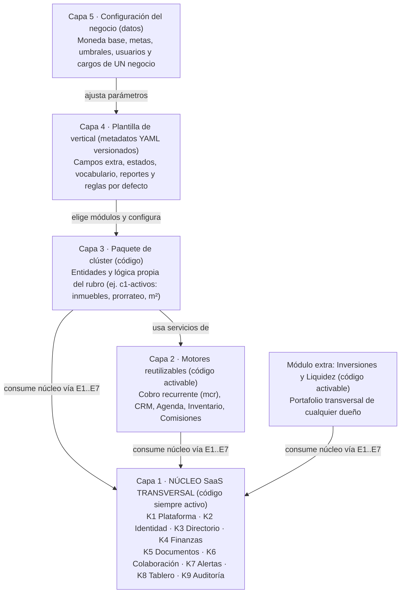

#### Frontera normativa entre Metadatos y Código

| Se resuelve con metadatos (Capa 4 · Plantilla) | Requiere código (Capa 2 · Motor o Capa 3 · Paquete) |
|------------------------------------------------|------------------------------------------------------|
| Campos adicionales tipados sobre fichas del núcleo (JSON Schema) | Cálculos algorítmicos propios (prorrateo por consumo, rendimiento por m² depreciado, costo promedio) |
| Estados y transiciones de un flujo Kanban | Movimientos con invariantes de consistencia (Kardex, saldos bancarios, emisión periódica idempotente) |
| Etiquetas y vocabulario de negocio ("Inquilino", "Paciente", "Cuota") | Detección de traslapes horarios o disponibilidad de recursos |
| Permisos por defecto asociados a cargos del negocio | Integraciones con APIs externas (SUNAT PSE/OSE, WhatsApp Business, OCR) |
| Reportes tabulares y plantillas PDF/correo sobre datos existentes | Reglas que exigen atomicidad transaccional entre múltiples entidades del rubro |
| Días de umbral y canales de alertas | Interfaces especializadas de alto volumen o modo fuera de línea |

### 2.2 Contexto del sistema (C4 Nivel 1)

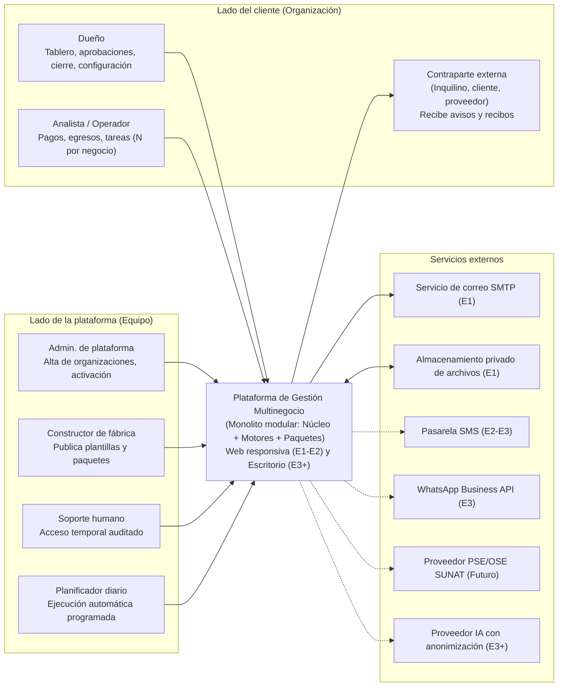

### 2.3 Las dos fronteras: Organización y Negocio

El modelo multi-tenant separa estrictamente la **frontera de seguridad (`Organizacion`)** de la **frontera operativa (`Negocio`)** (`NUC-Q-04`):

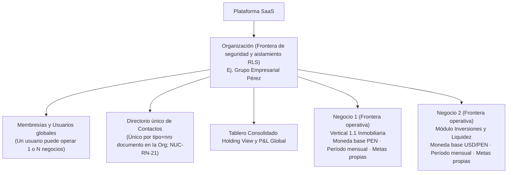

- **En `Organizacion` viven:** suscripción y estado de cuenta con la plataforma, membresías de usuarios, el catálogo único de `Contacto` por documento (no se comparte morosidad entre organizaciones distintas, `NUC-RN-21`), la vista consolidada del dueño (`K8`) y todas las políticas **PostgreSQL RLS** mediante `organizacion_id`.
- **En `Negocio` viven:** la plantilla activa y su versión, los módulos activados (`Activacion`), la moneda base de trabajo, el calendario mensual de `Periodo`, las cuentas de tesorería, las obligaciones, los pagos, los movimientos, los objetivos mensuales, los permisos operativos del analista (`Membresia.negocios`) y las reglas específicas de alerta/aprobación. Un período retrasado en `Negocio 1` **no bloquea** el cierre de `Negocio 2` (`NUC-D-12`).

### 2.4 Los 9 contextos del núcleo (`K1` a `K9`)

| Código | Contexto delimitado | Tipo DDD | Etapa | Conceptos principales |
|:------:|---------------------|----------|:-----:|------------------------|
| **`K1`** | Plataforma y catálogo | Soporte | E1 | `Organizacion`, `Negocio`, `Modulo`, `VersionModulo`, `Plantilla`, `Activacion`, `Suscripcion` |
| **`K2`** | Identidad y acceso | Genérico | E1–2 | `Usuario`, `Membresia`, `Cargo`, `Permiso`, `AccesoSoporte` |
| **`K3`** | Directorio | Soporte | E1–2 | `Contacto`, `PapelContacto`, `CalificacionPago` |
| **`K4`** | **Finanzas** | **Central** | E1–2 | `Obligacion`, `Pago`, `Aplicacion`, `ComprobantePago`, `LoteVerificacion`, `Cuenta`, `Movimiento`, `Categoria`, `CentroCosto`, `FondoTerceros`, `Periodo` |
| **`K5`** | Documentos | Genérico | E1–2 | `Documento`, `TipoDocumento`, `PlantillaPDF` |
| **`K6`** | Colaboración | Soporte | E1–2 | `Tarea`, `SolicitudAprobacion`, `ReglaAprobacion`, `Mensaje`, `FlujoEstado`, `Calculadora` |
| **`K7`** | Alertas y notificaciones | Soporte | E1–3 | `ReglaAlerta`, `Alerta`, `Notificacion`, `TrabajoProgramado` |
| **`K8`** | Tablero y reportes | Soporte | E2 | Vistas sobre `Movimiento` + `E2`: `Objetivo`, `Indicador`, `Tarjeta`, `EstadoResultadosPL`, `GraficoEvolucion` |
| **`K9`** | Configuración y auditoría | Genérico | E1 | `Parametro` (con `vigente_desde`), `CampoConfigurable`, `RegistroAuditoria` |

#### Grafo de dependencias entre contextos (acíclico)

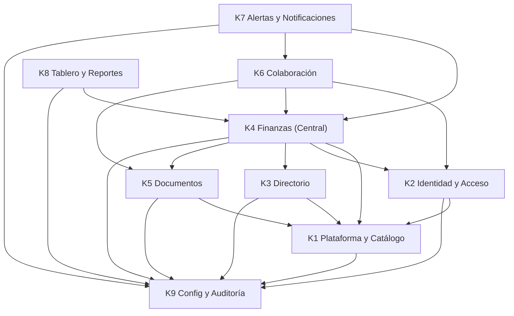

*Regla estructural:* `K4 Finanzas` nunca invoca directamente a `K8 Tablero`; la comunicación hacia `K6`, `K7` y módulos externos ocurre mediante el bus de eventos de dominio (`NUC-EV-01` a `NUC-EV-15`).

### 2.5 Actores, roles y matriz de privilegios RBAC

Los permisos se evalúan por **acción granular** (`NUC-D-03`) en el servidor (`NUC-RNF-01`) y se agrupan en `Cargo`s definidos por la plantilla (Capa 4) o ajustados por el `Dueño`.

| Actor | Ámbito | Responsabilidad principal |
|-------|--------|---------------------------|
| **Administrador de plataforma** | Plataforma | Crea organizaciones, asigna suscripciones, habilita verticales y publica versiones. No accede a datos operativos del cliente sin soporte autorizado. |
| **Constructor de la fábrica** | Plataforma | Diseña y versiona motores, paquetes de clúster y plantillas YAML; ejecuta pruebas antes de publicar. |
| **Soporte humano** | Plataforma → Org | Acompaña al cliente o diagnostica incidencias únicamente mediante `AccesoSoporte` temporal, autorizado por el `Dueño` y auditado (`NUC-RF-19`, `NUC-I-13`). |
| **Asistente IA (E3+)** | Plataforma | Asiste en clasificación de negocios nuevos y sugerencias; **nunca** publica configuraciones ni altera datos reales sin aprobación humana (`NUC-RN-23`). |
| **Dueño** | Su `Organizacion` | Administrador completo de sus negocios: configura metas/parámetros, gestiona usuarios y cargos, aprueba egresos/excepciones, cierra períodos (y reabre excepcionalmente), visualiza el Holding View, P&L y auditoría. *(Distinto al Admin. de plataforma).* |
| **Analista / Operador** | 1..N `Negocio`s | Opera el día a día (contactos, cobros, vouchers, egresos, tareas). Sujeto estricto a `NUC-RN-12` y `NUC-RN-30`: **ve montos individuales operativos, pero jamás sumas, subtotales, saldos bancarios ni utilidades**. |
| **Contraparte externa** | Externa | Recibe avisos preventivos, recibos PDF o saludos institucionales por correo (o canales futuros); no inicia sesión en Etapa 1–2. |
| **Planificador diario** | Sistema | Actor técnico automático que dispara a diario las rondas de `K7` y `E6` independientemente de si algún usuario abre la aplicación (`NUC-RNF-09`). |

#### Matriz de privilegios por defecto del núcleo

Leyenda: `SI` = permitido por defecto · `NO` = prohibido · `CONF` = configurable por plantilla/cargo · `AUT` = solo con `AccesoSoporte` vigente otorgado por el Dueño.

| Acción / Permiso | Admin. Plataforma | Soporte Humano | Dueño | Analista (default C1) |
|------------------|:-----------------:|:--------------:|:-----:|:---------------------:|
| `plataforma.gestionar_organizaciones` | `SI` | `NO` | `NO` | `NO` |
| `plataforma.publicar_modulos` | `SI` | `NO` | `NO` | `NO` |
| `negocio.solicitar_o_activar` | `SI` | `AUT` | `SI` (solicita) | `NO` |
| `usuarios.gestionar_membresias` | `NO` | `AUT` | `SI` | `NO` |
| `soporte.autorizar_acceso` | `NO` | `NO` | `SI` | `NO` |
| `contactos.gestionar` | `NO` | `AUT` | `SI` | `SI` |
| `finanzas.registrar_obligacion` | `NO` | `AUT` | `SI` | `CONF` (`SI` en C1) |
| `finanzas.registrar_pago` | `NO` | `AUT` | `SI` | `SI` |
| `finanzas.verificar_pago` | `NO` | `NO` | `SI` | `CONF` (`SI` en C1; `NUC-Q-37`) |
| `finanzas.registrar_egreso` | `NO` | `AUT` | `SI` | `SI` (con aprobación) |
| `finanzas.aprobar_egreso` | `NO` | `NO` | `SI` | `NO` |
| `finanzas.conciliar_y_transferir` | `NO` | `NO` | `SI` | `NO` |
| `finanzas.revertir_movimiento` | `NO` | `NO` | `SI` | `NO` |
| `finanzas.ver_totales` (`NUC-RN-30`) | `NO` | `AUT` | `SI` | **`NO` (invariante operativo)** |
| `periodo.cerrar` | `NO` | `NO` | `SI` | `NO` |
| `periodo.reabrir` (excepcional) | `NO` | `NO` | `SI` | `NO` |
| `documentos.adjuntar_y_consultar` | `NO` | `AUT` | `SI` | `SI` (sin sensibles `D4` restringidos) |
| `tareas.asignar_y_ejecutar` | `NO` | `NO` | `SI` | `SI` (`NUC-Q-29`) |
| `tareas.aprobar_cierre` | `NO` | `NO` | `SI` | `CONF` (solo tareas asignadas por él; nunca propias) |
| `tablero.ver_holding_y_pl` | `NO` | `NO` | `SI` | **`NO`** |
| `parametros.configurar` | `NO` | `AUT` | `SI` | `NO` |
| `auditoria.consultar` | `SI` (solo eventos de plataforma) | `NO` | `SI` (su organización) | `NO` |

> **Regla crítica de ocultamiento de agregados (`NUC-RN-12` y `NUC-RN-30`):** Cuando el usuario autenticado carezca del permiso `finanzas.ver_totales`, la API del servidor **no debe calcular ni devolver** campos totales en la respuesta JSON/HTML, ni filas de sumatoria en tablas, ni pies de totales en exportaciones PDF/Excel, ni contadores globales de recaudación diaria, semanal o mensual.

### 2.6 Modelo de despliegue y operación (Ronda 2)

Según la definición de arquitectura confirmada en Ronda 2 (24/Nov/2026, `NUC-Q-32`, `NUC-Q-33`), todo el backend, base de datos PostgreSQL, almacenamiento de archivos y planificador corren en **servidores operados por el equipo de desarrollo** (no en nube pública autoadministrada por terceros sin control ni instalados en hardware propio del cliente):

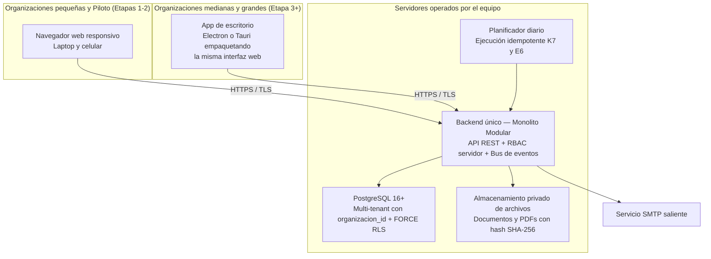

#### Organización interna de componentes (C4 Nivel 3)

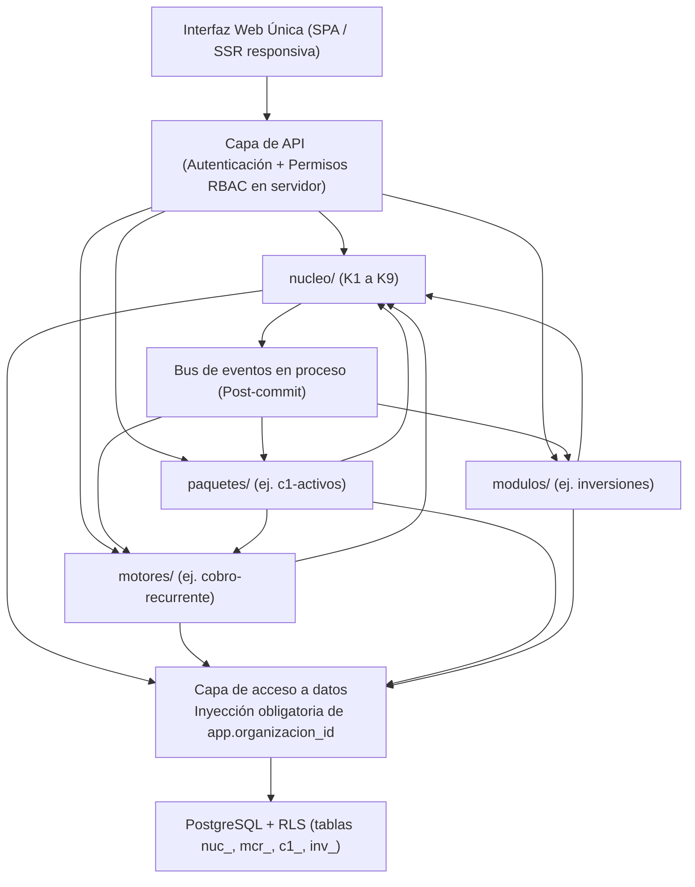

### 2.7 Restricciones, suposiciones y plan incremental

**Restricciones:**
- Equipo de 3 desarrolladores a tiempo parcial durante ~2 semestres, con experiencia en desarrollo web y SQL.
- Presupuesto acotado para servicios externos: priorizar SMTP estándar en Etapa 1 y postergar SMS/WhatsApp/OCR/IA a Etapas 2–3+.
- Solo el Clúster 1 cuenta con validación de cliente real (cliente piloto con 1 analista y 11 unidades iniciales); los clústeres `C2`–`C6` son referencia arquitectónica para garantizar extensibilidad sin sobreingeniería.

**Suposiciones y dependencias:**
- El servidor operado por el equipo cuenta con conectividad saliente SMTP para correo transaccional, respaldo automático externo de PostgreSQL y archivos, y reloj sincronizado por NTP con zona horaria `America/Lima` por defecto.
- La definición cuantitativa del umbral entre empresa "pequeña" (web) y "mediana/grande" (escritorio) queda postergada hasta la llegada del primer cliente mediano (`NUC-Q-31`).

**Plan de 5 incrementos del núcleo:**
1. **Incremento 1 (Base segura):** `K1`, `K2`, `K9` (organizaciones, negocios, usuarios, RBAC, auditoría, RLS).
2. **Incremento 2 (Directorio y cobranza mínima):** `K3`, `K5`, `K4` básico (`Obligacion`, `Pago`, `ComprobantePago`, `Movimiento`).
3. **Incremento 3 (Planificación y avisos):** `K7` (bandeja de alertas, correo SMTP, planificador diario) + contrato `E1`/`E6`.
4. **Incremento 4 (Colaboración y tesorería):** `K4` egresos, aprobación de gastos y cierre parcial; `K6` tareas básicas (`NUC-RF-40`–`42`) y mensajería anclada.
5. **Incremento 5 (Tablero, cierre integral y consolidación):** `K4` lotes por cierre de caja, fondos de terceros, multimoneda, conciliación y reapertura controlada; `K8` Holding View, P&L y gráficos de evolución.

---

## 3. Requerimientos Específicos

### 3.1 Interfaces Externas e Internas (Puntos de Extensión)

#### 3.1.1 Interfaces de usuario

- **Idioma y formato regional:** español (`es-PE`) en etiquetas, mensajes de validación y plantillas; separador decimal punto (`.`) y miles coma (`,`), moneda por defecto `S/` (`PEN`) y soporte nativo de `US$` (`USD`); fechas en formato legible `DD/MM/YYYY` en UI y `YYYY-MM-DD` ISO 8601 en almacenamiento.
- **Usabilidad operativa (`NUC-RNF-06`):** el flujo completo de registrar un cobro con su voucher adjunto y selección de obligación debe completarse en **≤ 3 pasos**.
- **Diseño responsivo y empaquetable:** usable desde laptop (`>= 1280 px`) y móvil (`>= 360 px`) en navegador moderno (Etapa 1–2); misma interfaz empaquetable en contenedor de escritorio (Etapa 3+).
- **Invariante de presentación por rol (`NUC-RN-30`):** cuando el usuario carezca de `finanzas.ver_totales`, la interfaz omitirá tarjetas de totales, sumatorias al pie de tabla, resúmenes recaudados y botones de exportación que agreguen dinero.

#### 3.1.2 Interfaces de hardware

No se requiere hardware propietario. En Etapas 1–2 basta cualquier computador portátil o teléfono inteligente con navegador moderno y cámara (para captura opcional de comprobantes o lecturas).

#### 3.1.3 Interfaces de software externo

| Sistema externo | Propósito | Etapa | Requerimiento | Comportamiento ante fallo |
|-----------------|-----------|:-----:|---------------|---------------------------|
| **Servidor SMTP / API Correo** | Envío de alertas de vencimiento, recibos PDF y saludos | E1 | `NUC-RF-08` | Marca `Notificacion` como `Fallida`, reintenta con backoff exponencial hasta 3 veces y mantiene la `Alerta` activa en bandeja `app`. |
| **Almacenamiento privado de archivos** | Persistencia de vouchers, DNI, contratos y PDFs generados | E1 | `NUC-RF-10` | Ninguna URL pública directa; descarga exclusivamente vía endpoint autenticado que valida `organizacion_id`, `negocio_id` y permisos. |
| **Pasarela SMS** | Alertas críticas por mensaje de texto | E2–3 | `NUC-RF-09` | Adaptador intercambiable; si falla o excede cuota mensual, registra fallo y notifica por correo/bandeja sin bloquear la ronda diaria. |
| **WhatsApp Business API** | Envío de recordatorios y recepción de comprobantes | E3 | `NUC-RF-80` | Cola asíncrona con estado de entrega; todo voucher entrante entra como `Pago` en estado `Por verificar` (`NUC-RN-04`). |
| **Motor OCR / Lectura de comprobantes** | Extraer fecha, monto y nro de operación sugeridos de una imagen/PDF | E3 | `NUC-RF-82` | Degradación transparente: si falla o tiene baja confianza, el operador ingresa los valores manualmente; nunca confirma pagos automáticamente (`NUC-RN-04`). |
| **PSE / OSE SUNAT** | Emisión futura de boleta/factura electrónica | Futura (`NUC-Q-07`) | `NUC-RF-38` | Adaptador desacoplado fuera de Etapa 1–2; si el negocio tiene facturación electrónica desactivada, emite recibos PDF internos (`NUC-RF-35`). |
| **Proveedor de IA (LLM)** | Entrevista asistida para clasificar nuevos negocios | E3+ | `NUC-RF-23` | Envía solo descripción de procesos del negocio (nunca PII ni datos financieros reales, `NUC-Q-14`) y requiere aprobación humana (`NUC-RN-23`). |

#### 3.1.4 Interfaces de comunicaciones

- Todo tráfico cliente-servidor operará exclusivamente sobre **HTTPS (TLS 1.2 o superior)** con redirección forzada desde HTTP.
- Las sesiones HTTP emplearán cookies seguras (`HttpOnly`, `Secure`, `SameSite=Lax`) o tokens rotativos gestionados en servidor con expiración configurable.
- Toda petición autenticada resuelve `usuario_id`, `organizacion_id` y `negocio_id` en el middleware de API antes de abrir transacción en PostgreSQL, estableciendo la variable de sesión `app.organizacion_id` consumida por las políticas RLS.

#### 3.1.5 Interfaces internas: Puntos de Extensión (`E1`–`E7`), Declaraciones (`D1`–`D4`) y Eventos (`NUC-EV-01`–`15`)

El núcleo expone contratos formales implementados por motores (Capa 2), paquetes de clúster (Capa 3) o módulos extra:

##### Tabla de Contratos de Extensión (`E1` a `E7`)

| Punto | Nombre | Qué entrega el motor/paquete | Qué hace el núcleo con ello | Validación / Ejemplo |
|:-----:|--------|------------------------------|-----------------------------|----------------------|
| **`E1`** | **Generador de obligaciones** | Función registrada `generar_obligaciones(negocio_id, fecha_corte) -> Lista<PropuestaObligacion>` | Verifica idempotencia, resuelve `Contacto` y `CentroCosto`, crea `Obligacion` en `K4`, emite `NUC-EV-04`. | `mcr` genera cuotas de alquiler; `c1-activos` genera prorrateos de agua/luz. |
| **`E2`** | **Indicador del tablero** | Función `calcular_indicador_meta(negocio_id, periodo) -> IndicadorMeta(etiqueta, valor_actual, objetivo, estado_semaforo, url_detalle)` | Combina `monto cobrado del mes / objetivo` (calculado por `K4` desde `Movimiento`) con el `IndicadorMeta` del paquete en la tarjeta de `K8`. | `c1-activos`: ocupación `unidades ocupadas / alquilables` (verde = 100 %). Sin paquete: variación de clientes activos `> 0`. |
| **`E3`** | **Condiciones de cierre** | Lista de validadores `validar_cierre(negocio_id, periodo) -> Lista<ResultadoCondicion(codigo, descripcion, aprobado, detalle)>` y opcionalmente `autoriza_reapertura(negocio_id, periodo, motivo)` | Impide `periodo.cerrar` si alguna condición falla (`NUC-I-11`). Permite `Cerrado -> Reabierto` solo si una condición autorizada de paquete lo habilita. | `c1-activos`: cuotas del mes generadas, prorrateos conciliados y recibos pagados; reapertura solo por cobro de incobrable (`C1-RN-48`). |
| **`E4`** | **Política de verificación** | Configuración declarada: `modo` (`por_pago` o `por_cierre_de_caja`) y `permiso_requerido` (`finanzas.verificar_pago`) | Agrupa automáticamente los `Pago`s en `LoteVerificacion` de 1 pago o de turno/día y exige el permiso al resolver el lote. | `c1-activos`: `por_pago`; en piloto, `Dueño` y `Analista` poseen el permiso; `C4`/`C6`: `por_cierre_de_caja`. |
| **`E5`** | **Suscripción a eventos** | Registro de manejadores por `evento_tipo` | Tras confirmar el `COMMIT` de base de datos, despacha el evento al bus en proceso respetando el `organizacion_id` de contexto. | `mcr`/`c1` escuchan `pago.verificado` para actualizar historial del inquilino; `K7` escucha `obligacion.vencida`. |
| **`E6`** | **Tareas programadas** | Registro `TrabajoExterno(codigo, cron_diario, handler)` | El planificador diario (`K7`) lo invoca por cada negocio activo con el módulo habilitado y registra resultado/error en `RegistroTrabajo`. | `c1-activos`: recordar toma de lecturas el día 25; `mcr`: alertar contratos por vencer. |
| **`E7`** | **Criterios de calificación** | Función `evaluar_criterios(organizacion_id, negocio_id, contacto_id) -> PuntajeParcial` | `K3` pondera los criterios declarados junto con los parámetros configurables en `K9` y recalcula el semáforo (`verde`/`ambar`/`rojo`). | `c1-activos`: peso de atraso en cuotas e incidencias de mantenimiento/limpieza. |

##### Declaraciones estáticas de módulo (`D1` a `D4`)

Al registrar un `Modulo` o `Plantilla`, este declara metadatos estáticos validados en el arranque:
- **`D1` Tipos de registro:** códigos válidos para `RefRegistro.tipo` y orígenes de `CentroCosto` (ej. `c1.inmueble`, `c1.departamento`, `mcr.contrato`).
- **`D2` Permisos y cargos:** permisos propios del paquete (ej. `c1.leer_medidores`) y asignación inicial a cargos base de la plantilla.
- **`D3` Menús, vocabulario y esquemas de campos extra:** rutas de menú, glosario de reemplazo en UI (ej. `contacto.cliente = "Inquilino"`, `obligacion = "Cuota"`) y **JSON Schema** para validar `campos_adicionales` en entidades extensibles.
- **`D4` Datos sensibles:** marca explícita de campos o tipos de documento que contienen información sensible (salud, DNI, boletas, credenciales) para aplicar cifrado adicional o acceso restringido (`NUC-RNF-21`).

##### Catálogo de eventos del núcleo (`NUC-EV-01` a `NUC-EV-15`)

Todo evento emitido incluye el sobre estándar: `{ evento_id, tipo, ocurrido_en, organizacion_id, negocio_id, usuario_id, ref_registro, payload }`.

| ID | Evento | Momento de emisión (siempre post-commit) |
|----|--------|----------------------------------------|
| `NUC-EV-01` | `negocio.activado` | Un `Negocio` pasa a estado `Activo` tras aprovisionarse plantilla y módulos. |
| `NUC-EV-02` | `modulo.activado` / `modulo.desactivado` | Cambia el estado de una `Activacion` de motor, paquete o módulo extra en un negocio. |
| `NUC-EV-03` | `contacto.creado` | Alta confirmada de un `Contacto` en `K3`. |
| `NUC-EV-04` | `obligacion.emitida` | Nace una `Obligacion` manual o mediante generador `E1`. |
| `NUC-EV-05` | `obligacion.por_vencer` | Faltan `N` días (según `ReglaAlerta`) para `vence_en` y `saldo > 0`. |
| `NUC-EV-06` | `obligacion.vencida` | Supera `vence_en` con `saldo > 0`. |
| `NUC-EV-07` | `obligacion.pagada` | La suma de aplicaciones verificadas deja `saldo = 0`. |
| `NUC-EV-08` | `pago.registrado` | Se registra un `Pago` en estado `Por verificar`. |
| `NUC-EV-09` | `pago.verificado` | Una persona autorizada aprueba el `Pago` / `LoteVerificacion` y nace su `Movimiento`. |
| `NUC-EV-10` | `pago.rechazado` / `pago.revertido` | Se rechaza un pago pendiente o se emite una reversa de un movimiento verificado. |
| `NUC-EV-11` | `aprobacion.solicitada` / `aprobacion.resuelta` | Creación, aprobación, rechazo o retiro de `SolicitudAprobacion`. |
| `NUC-EV-12` | `tarea.asignada` / `tarea.por_aprobar` / `tarea.vencida` | Transiciones relevantes del ciclo de `Tarea`. |
| `NUC-EV-13` | `periodo.cerrado` | Confirmación de cierre mensual de un `Periodo`. |
| `NUC-EV-14` | `alerta.escalada` | Una `Alerta` vence `escalar_tras` sin ser atendida y escala al supervisor/dueño. |
| `NUC-EV-15` | `periodo.reabierto` | Reapertura excepcional y auditada de un `Periodo` por el `Dueño` (`C1-RN-48`). |

##### Ejemplo declarativo normativo de paquete y plantilla (Ronda 2)

```yaml
# Paquete (Capa 3): declara capacidades técnicas en código
modulo: c1-activos
tipo: paquete
version: 0.1.0
requiere_nucleo: ">=1.0.0"
dependencias_motores: ["cobro-recurrente>=1.0.0"]
declaraciones_d1_tipos: ["c1.inmueble", "c1.unidad", "c1.lectura", "c1.servicio_recibo"]
extensiones_e1_generadores: ["c1.prorrateo_servicios"]
extension_e2_tablero: "c1.indicador_ocupacion"
extension_e3_cierre: ["c1.cuotas_emitidas", "c1.prorrateos_conciliados", "c1.servicios_pagados"]
extension_e4_verificacion: { modo: "por_pago", permiso: "finanzas.verificar_pago" }
extension_e5_eventos: ["pago.verificado", "obligacion.vencida", "periodo.cerrado"]
extension_e6_trabajos: [{ codigo: "c1.recordatorio_lecturas", dia_mes: 25 }]
```

```yaml
# Plantilla (Capa 4): selección declarativa para Vertical 1.1 Inmobiliaria (Piloto)
plantilla: "1.1-inmobiliaria"
version: "1.0.0"
modulos: ["c1-activos", "cobro-recurrente"]
modulos_extra_permitidos: ["inversiones-y-liquidez"]
vocabulario:
  contacto.cliente: "Inquilino"
  obligacion: "Cuota"
  centro_costo: "Inmueble / Unidad"
cargos_por_defecto:
  Dueño: ["*"]
  Analista:
    - "contactos.*"
    - "finanzas.registrar_obligacion"
    - "finanzas.registrar_pago"
    - "finanzas.verificar_pago"
    - "finanzas.registrar_egreso"
    - "documentos.*"
    - "tareas.*"
    - "-finanzas.ver_totales"
    - "-periodo.*"
reglas_alerta_por_defecto:
  - { evento: "obligacion.vencida", dias: 7, canales: ["app", "correo"], destinatario: "Analista" }
  - { evento: "obligacion.vencida", dias: 7, canales: ["app", "correo"], destinatario: "Dueño" }
```

**Prohibiciones arquitectónicas estrictas:**
1. Ningún paquete ni motor puede ejecutar sentencias `INSERT`/`UPDATE`/`DELETE` directas sobre tablas `nuc_*`; debe invocar los servicios de dominio del núcleo que garantizan auditoría e invariantes.
2. Ningún paquete de clúster (`C1`–`C6`) puede leer o importar directamente tablas o servicios de otro paquete de clúster.
3. El directorio de código `nucleo/` no puede contener referencias condicionales ni importaciones hacia `motores/`, `paquetes/` o `modulos/`.

---

### 3.2 Requerimientos Funcionales por Contexto (`K1` a `K9`)

#### 3.2.1 `K1` — Plataforma y Catálogo

**Responsabilidad:** Administrar el ciclo de vida multi-tenant de organizaciones, negocios, módulos versionados y plantillas declarativas, garantizando que activar o actualizar un módulo no degrade negocios existentes.

##### Casos de uso de `K1`

- **`NUC-CU-01`: Dar de alta organización y suscripción**
  - *Actor principal:* Administrador de plataforma.
  - *Precondición:* Sesión de administrador de plataforma autenticada.
  - *Flujo principal:* (1) Registra razón social/nombre comercial, RUC o identificador fiscal, datos del contacto dueño inicial y tipo de suscripción (`fundador` | `regular`). (2) El sistema genera la `Organizacion`, inicializa la membresía inicial con rol `Dueño` y registra evento en auditoría. (3) Envía invitación de activación de contraseña al correo del dueño.
  - *Postcondición:* Organización en estado `Activa` aislada por `organizacion_id`.
- **`NUC-CU-02`: Activar negocio con plantilla y módulos**
  - *Actor principal:* Administrador de plataforma (o flujo acompañado desde solicitud del Dueño en Etapa 3+, `NUC-Q-05`).
  - *Precondiciones:* Organización activa; plantilla y versión de módulos publicadas y verificadas.
  - *Flujo principal:* (1) Selecciona la `Organizacion`, nombre del `Negocio`, moneda base (`PEN`/`USD`) y `Plantilla` (ej. `1.1-inmobiliaria`). (2) El sistema valida dependencias entre módulos requeridos (`c1-activos` → `cobro-recurrente`), crea registros `Activacion`, aplica parámetros y reglas por defecto en `K9`, inicializa el primer `Periodo` `Abierto` y publica `NUC-EV-01` (`negocio.activado`).
  - *Excepción:* Si falla una migración o falta dependencia, revierte atómicamente la transacción sin afectar otros negocios (`OE-NUC-02`).

##### Ciclo de vida de `Negocio`

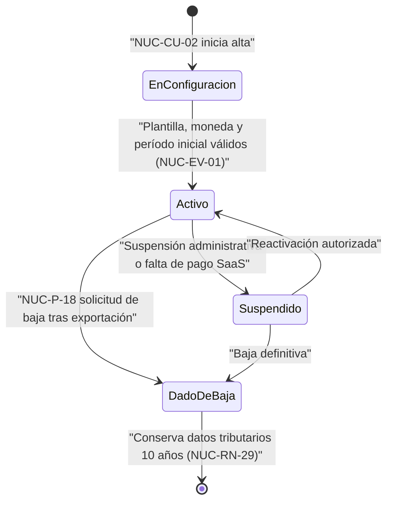

| Estado | Qué se puede hacer y quién |
|--------|---------------------------|
| `EnConfiguracion` | Solo Admin./Soporte cargan parámetros iniciales y migración Excel; operación diaria bloqueada. |
| `Activo` | Operación completa según RBAC; el planificador diario incluye el negocio. |
| `Suspendido` | Solo lectura y exportación para Dueño; prohíbe nuevos cobros/movimientos y pausa generación automática. |
| `DadoDeBaja` | Solo lectura/descarga histórica de documentos y contabilidad protegida hasta `conservar_hasta` (`>= 10 años`). |

##### Requerimientos funcionales de `K1`

```text
ID:            NUC-RF-04
Nombre:        Gestión de N negocios por organización con objetivo mensual
Contexto:      K1 Plataforma y Catálogo
Prioridad:     S (Etapa 1 base técnica; multi-negocio visible en tablero en Etapa 2)
Origen:        [CONFIRMADO] NUC-P-00, NUC-RN-18
Descripción:   El sistema debe permitir asociar N negocios independientes dentro de una misma
               organización, cada uno con nombre comercial, moneda base, zona horaria, estado
               operativo y objetivo mensual de cobranza/resultado configurable por período.
Reglas:        NUC-RN-18, NUC-RN-25, NUC-D-12
Invariantes:   NUC-I-01
Casos de uso:  NUC-CU-02, NUC-CU-23
Criterio de aceptación:
  Dada una organización con un negocio inmobiliario en PEN,
  cuando se activa un segundo negocio en USD bajo la misma organización,
  entonces ambos aparecen aislados operativamente en la organización y ninguno hereda saldos ni períodos del otro.
```

```text
ID:            NUC-RF-13
Nombre:        Aislamiento lógico multi-tenant por organización desde el esquema base
Contexto:      K1 Plataforma y Catálogo
Prioridad:     M          Etapa: 1
Origen:        [EQUIPO] NUC-RN-20, NUC-Q-04
Descripción:   Toda tabla operativa y de negocio del núcleo y de sus extensiones debe incluir
               obligatoriamente `organizacion_id` indexado y estar protegida por políticas de
               Row-Level Security (RLS) en PostgreSQL sobre la sesión activa de base de datos.
Reglas:        NUC-RN-20, NUC-RN-21
Invariantes:   NUC-I-01
Casos de uso:  NUC-CU-01, NUC-CU-04
Criterio de aceptación:
  Dadas dos organizaciones A y B en la misma instancia de base de datos,
  cuando una sesión autenticada de la organización A ejecuta una consulta directa o vía API
  con un ID perteneciente a la organización B,
  entonces el servidor y PostgreSQL retornan cero filas y registran intento denegado sin filtrar metadatos de B.
```

```text
ID:            NUC-RF-14
Nombre:        Catálogo versionado de motores, paquetes y verticales con activación por negocio
Contexto:      K1 Plataforma y Catálogo
Prioridad:     M          Etapa: 1
Origen:        [EQUIPO] OE-NUC-01, OE-NUC-03
Descripción:   El sistema debe mantener un registro de módulos (tipo: motor, paquete o modulo_extra),
               sus versiones semánticas y dependencias, permitiendo activar módulos específicos
               sobre un negocio sin modificar el código del núcleo.
Reglas:        NUC-RN-24
Invariantes:   NUC-I-01
Casos de uso:  NUC-CU-02
Criterio de aceptación:
  Dado un negocio nuevo sin módulos extra,
  cuando el administrador activa el paquete `c1-activos` v0.1.0,
  entonces el sistema exige y activa automáticamente su dependencia `cobro-recurrente` y emite `NUC-EV-02`.
```

```text
ID:            NUC-RF-15
Nombre:        Configuración declarativa por plantilla de vertical
Contexto:      K1 Plataforma y Catálogo
Prioridad:     S          Etapa: 2 (estructura lista en E1 por archivos YAML)
Origen:        [EQUIPO] NUC-P-15, D1–D4
Descripción:   El sistema debe cargar definiciones de plantilla (archivos YAML versionados en Etapa 1-2)
               para inicializar automáticamente campos adicionales (JSON Schema), estados permitidos,
               etiquetas de vocabulario en interfaz, permisos por cargo y reglas de alerta por defecto.
Reglas:        NUC-RN-24, NUC-RN-25
Invariantes:   NUC-I-01
Casos de uso:  NUC-CU-02
Criterio de aceptación:
  Dada la plantilla `1.1-inmobiliaria` con vocabulario `contacto.cliente = "Inquilino"`,
  cuando se renderiza el directorio en ese negocio,
  entonces la interfaz muestra "Inquilino" mientras un negocio sin plantilla muestra "Cliente".
```

```text
ID:            NUC-RF-16
Nombre:        Panel interno de administración de organizaciones, negocios y versiones
Contexto:      K1 Plataforma y Catálogo
Prioridad:     S          Etapa: 2
Origen:        [EQUIPO] NUC-CU-01, NUC-CU-02
Descripción:   Proveer una consola interna exclusiva del Administrador de plataforma para listar
               organizaciones, crear o suspender negocios, consultar qué versión de plantilla y paquete
               ejecuta cada negocio y revisar solicitudes pendientes, sin exponer datos contables del cliente.
Reglas:        NUC-RN-20, NUC-RN-22
Invariantes:   NUC-I-01, NUC-I-13
Casos de uso:  NUC-CU-01, NUC-CU-02
Criterio de aceptación:
  Dado un administrador de plataforma autenticado sin AccesoSoporte vigente para la Org X,
  cuando accede al panel interno,
  entonces visualiza estado y versión de los negocios de Org X pero no puede consultar sus pagos ni documentos.
```

```text
ID:            NUC-RF-20
Nombre:        Exportación completa de datos y documentos de una organización o negocio
Contexto:      K1 Plataforma y Catálogo
Prioridad:     S          Etapa: 3 (base parcial en E2)
Origen:        [EQUIPO] NUC-P-18, NUC-RNF-20
Descripción:   Permitir al Dueño generar un paquete descargable en formatos abiertos (CSV/JSON + PDFs/adjuntos
               originales + manifiesto de hashes SHA-256) con toda la información de un negocio o de toda su organización.
Reglas:        NUC-RN-22, NUC-RN-29
Invariantes:   NUC-I-01, NUC-I-12
Casos de uso:  NUC-CU-02
Criterio de aceptación:
  Dado un negocio dado de baja o activo,
  cuando el Dueño solicita la exportación completa,
  entonces el sistema genera un archivo ZIP con CSV/JSON y documentos originales verificables y lo registra en auditoría.
```

```text
ID:            NUC-RF-21
Nombre:        Publicación progresiva por tandas y reversión de versiones de plantilla
Contexto:      K1 Plataforma y Catálogo
Prioridad:     C          Etapa: 3
Origen:        [INFERIDO] NUC-P-17, NUC-RNF-16
Descripción:   Permitir al Constructor publicar nuevas versiones de plantilla primero sobre un entorno/negocio
               de prueba, luego desplegar por lotes de organizaciones seleccionadas y revertir a la versión
               previa en caso de error sin perder datos personalizados del cliente.
Reglas:        NUC-RN-22, NUC-RN-24
Invariantes:   NUC-I-01
Casos de uso:  NUC-CU-02
Criterio de aceptación:
  Dada una plantilla v1.1 publicada únicamente en la tanda piloto,
  cuando los negocios de la tanda 2 operan normalmente,
  entonces conservan la versión v1.0 intacta hasta su migración controlada.
```

```text
ID:            NUC-RF-22
Nombre:        Flujo de solicitud, revisión y aprobación de negocio adicional
Contexto:      K1 Plataforma y Catálogo
Prioridad:     C          Etapa: 3 (temporalmente acompañado en E1-E2, NUC-Q-05)
Origen:        [EQUIPO] NUC-P-16
Descripción:   Permitir al Dueño registrar una solicitud formal de nuevo negocio describiendo el rubro,
               canalizando la clasificación de caso (A, B, C o D), cotización y aprobación humana previa
               al aprovisionamiento técnico en `NUC-CU-02`.
Reglas:        NUC-RN-22
Invariantes:   NUC-I-01
Casos de uso:  NUC-CU-02
Criterio de aceptación:
  Dada una solicitud de negocio adicional enviada por el Dueño,
  cuando Soporte humano la clasifica como Caso A y adjunta propuesta,
  entonces el negocio no se aprovisiona hasta registrar la aceptación del Dueño.
```

```text
ID:            NUC-RF-23
Nombre:        Asistente IA de entrevista y clasificación de plantillas con revisión humana
Contexto:      K1 Plataforma y Catálogo
Prioridad:     C          Etapa: 3+
Origen:        [EQUIPO] OE-NUC-07, NUC-P-16, NUC-Q-14
Descripción:   Módulo asistivo que guía una entrevista estructurada sobre la operación de un negocio nuevo,
               propone clúster, vertical y esquema preliminar de plantilla, registrando la sugerencia
               para validación obligatoria por el Constructor antes de cualquier publicación.
Reglas:        NUC-RN-23, NUC-RN-24
Invariantes:   NUC-I-01
Casos de uso:  NUC-CU-02
Criterio de aceptación:
  Dado un borrador de plantilla generado por el Asistente IA,
  cuando no existe aprobación registrada de un Constructor humano,
  entonces el borrador no puede asociarse ni activarse en ningún negocio de producción.
```

```text
ID:            NUC-RF-24
Nombre:        Facturación SaaS de la plataforma a organizaciones clientes
Contexto:      K1 Plataforma y Catálogo
Prioridad:     C          Etapa: 3+
Origen:        [EQUIPO] NUC-Q-10
Descripción:   Administrar planes, tarifas por negocio contratado, suscripciones (`fundador` | `regular`),
               ciclos de cobro de la propia plataforma SaaS y estado de cuenta del cliente frente al equipo operador.
Reglas:        NUC-RN-01, NUC-RN-25
Invariantes:   NUC-I-01, NUC-I-14
Casos de uso:  NUC-CU-01
Criterio de aceptación:
  Dada una organización con 2 negocios activos y plan mensual configurado,
  cuando vence el ciclo de facturación SaaS,
  entonces se genera la liquidación de plataforma sin mezclarse con las finanzas operativas de los negocios del cliente.
```

> **Nota de trazabilidad (`NUC-RF-85`):** El requerimiento preliminar `NUC-RF-85` (*"Plantillas para otros rubros"*) queda formalmente **reemplazado y absorbido** por `NUC-RF-14` y `NUC-RF-15` junto con los documentos propios de cada clúster (`C1`–`C6`).

---

#### 3.2.2 `K2` — Identidad y Acceso

**Responsabilidad:** Autenticar usuarios globales, asociarlos a organizaciones y negocios mediante membresías y cargos con permisos por acción (`RBAC` en servidor) y controlar el acceso temporal de soporte.

##### Casos de uso de `K2`

- **`NUC-CU-03`: Gestionar usuarios, membresías y cargos (Etapa 1)**
  - *Actor principal:* Dueño.
  - *Precondición:* Dueño autenticado con `usuarios.gestionar_membresias`.
  - *Flujo principal:* (1) Ingresa nombre, correo y cargo (ej. `Analista`) y alcance de negocios (uno, varios o toda la organización). (2) Si el correo ya existe como `Usuario` global, crea una nueva `Membresia` en esa organización sin mezclar sesiones ni datos de otras organizaciones (`NUC-D-02`); si no existe, crea `Usuario` + `Membresia`. (3) Permite ajustar permisos granulares del cargo (respetando que un operador no recibe `finanzas.ver_totales` por defecto) o desactivar la membresía.
  - *Postcondición:* Evento registrado en auditoría (`NUC-RF-12`).
- **`NUC-CU-04`: Iniciar sesión y elegir negocio activo (Etapa 1)**
  - *Actor principal:* Dueño, Analista, Admin. de plataforma o Soporte.
  - *Flujo principal:* (1) Usuario ingresa correo y contraseña. (2) Servidor valida hash (`Argon2id` o `bcrypt`), estado activo de usuario y membresía. (3) Si tiene acceso a 1 negocio, entra directamente; si tiene acceso a ≥ 2 negocios, selecciona el negocio activo (o Holding View si es Dueño). (4) El servidor carga únicamente las pantallas, menús y acciones autorizados en servidor.
  - *Excepción:* Tras 5 intentos fallidos consecutivos, aplica bloqueo temporal exponencial y registra alerta de seguridad.
- **`NUC-CU-05`: Otorgar y auditar acceso temporal de soporte (Etapa 2)**
  - *Actor principal:* Dueño (autoriza) y Soporte humano (opera).
  - *Flujo principal:* (1) El Dueño crea un `AccesoSoporte` indicando fecha/hora de expiración (`hasta`) y motivo (ej. "Revisión importación de Excel"). (2) Soporte ingresa usando dicha autorización dentro de la ventana vigente. (3) Cada lectura o acción queda grabada en `RegistroAuditoria` indicando tanto el operador de soporte como el `acceso_soporte_id`. (4) Al expirar `hasta` o revocarse manualmente, el acceso se corta automáticamente (`NUC-I-13`).

##### Requerimientos funcionales de `K2`

```text
ID:            NUC-RF-01
Nombre:        Autenticación segura con usuario y contraseña y selección de contexto
Contexto:      K2 Identidad y Acceso
Prioridad:     M          Etapa: 1
Origen:        [CONFIRMADO]
Descripción:   El sistema debe permitir iniciar y cerrar sesión mediante credenciales verificadas
               contra hashes seguros en servidor, soportando expiración de sesión por inactividad y
               selección de organización/negocio activo cuando el usuario pertenezca a más de uno.
Reglas:        NUC-RN-20, NUC-RN-22
Invariantes:   NUC-I-01
Casos de uso:  NUC-CU-04
Criterio de aceptación:
  Dado un usuario con membresía activa en la Org A,
  cuando inicia sesión con credenciales válidas,
  entonces obtiene una sesión cifrada en servidor con expiración definida y acceso exclusivo a los negocios asignados en Org A.
```

```text
ID:            NUC-RF-02
Nombre:        Gestión de N usuarios operativos, membresías y cargos por negocio
Contexto:      K2 Identidad y Acceso
Prioridad:     M          Etapa: 1
Origen:        [CONFIRMADO] NUC-RN-13
Descripción:   Permitir al Dueño crear, invitar, editar y desactivar N usuarios en su organización,
               asignándoles un Cargo y restringiendo el alcance de su membresía a toda la organización
               o a un subconjunto explícito de negocios.
Reglas:        NUC-RN-13, NUC-RN-20, NUC-RN-22
Invariantes:   NUC-I-01
Casos de uso:  NUC-CU-03
Criterio de aceptación:
  Dado un Analista asignado únicamente al Negocio 1,
  cuando intenta consultar URLs o APIs del Negocio 2 de la misma organización,
  entonces el servidor deniega la petición con HTTP 403 y no revela registros del Negocio 2.
```

```text
ID:            NUC-RF-03
Nombre:        Control de acceso por acción en servidor y ocultamiento de totales al operador
Contexto:      K2 Identidad y Acceso
Prioridad:     M          Etapa: 1
Origen:        [CONFIRMADO — P9] NUC-RN-12, NUC-RN-30
Descripción:   Toda ruta de interfaz, consulta, endpoint de API y exportación debe validar permisos por acción
               en el servidor antes de responder. Para cargos sin permiso `finanzas.ver_totales`,
               el servidor debe suprimir ganancias, rendimientos, valorizaciones, saldos bancarios y
               cualquier suma, subtotal o conteo monetario agregado en listas y reportes.
Reglas:        NUC-RN-12, NUC-RN-30
Invariantes:   NUC-I-01
Casos de uso:  NUC-CU-03, NUC-CU-04, NUC-CU-15
Criterio de aceptación:
  Dado un Analista sin permiso `finanzas.ver_totales`,
  cuando consulta la lista semanal de cobranza o la exporta,
  entonces ve el monto individual de cada cuota por cobrar pero el servidor omite toda fila o campo de suma total.
```

```text
ID:            NUC-RF-19
Nombre:        Acceso temporal de soporte con autorización expresa del Dueño y auditoría
Contexto:      K2 Identidad y Acceso
Prioridad:     S          Etapa: 2
Origen:        [EQUIPO] NUC-RN-22
Descripción:   El acceso del equipo de soporte a datos reales de una organización solo es posible si
               existe un registro `AccesoSoporte` activo emitido por el Dueño con motivo y fecha/hora
               de vencimiento, revocable en cualquier momento y completamente auditado.
Reglas:        NUC-RN-20, NUC-RN-22
Invariantes:   NUC-I-01, NUC-I-13
Casos de uso:  NUC-CU-05
Criterio de aceptación:
  Dado un registro `AccesoSoporte` con `hasta = 2026-11-26 18:00`,
  cuando un agente de soporte intenta acceder a las 18:01 o sin motivo registrado,
  entonces el servidor rechaza la conexión automáticamente.
```

---

#### 3.2.3 `K3` — Directorio

**Responsabilidad:** Centralizar personas y empresas únicas por organización (`Contacto`), asignarles roles operativos por negocio (`PapelContacto`) y calcular su calificación de comportamiento de pago (`CalificacionPago`).

##### Caso de uso de `K3`

- **`NUC-CU-06`: Registrar contacto, asignar papel y consultar calificación (Etapa 1)**
  - *Actor principal:* Dueño o Analista.
  - *Flujo principal:* (1) Busca por `tipo_documento` y `numero_documento` dentro de su propia `Organizacion` (`NUC-RN-21`). (2) Si existe, lo reutiliza y le agrega un `PapelContacto` para el `Negocio` actual (`cliente`, `proveedor`, `empleado`, etc.) con sus `campos_adicionales` validados por plantilla; si no existe, crea el `Contacto` con datos base y consentimiento Ley 29733 si aplica. (3) Al consultar su ficha en un negocio, muestra su historial operativo en ese negocio y su `CalificacionPago` (`verde`, `ambar`, `rojo`) calculada por reglas del núcleo + `E7`.
  - *Excepción:* Si se intenta crear un documento duplicado dentro de la misma organización, el sistema bloquea la duplicación y ofrece abrir la ficha existente.

##### Requerimientos funcionales de `K3`

```text
ID:            NUC-RF-34
Nombre:        Directorio unificado de contactos con múltiples papeles por negocio
Contexto:      K3 Directorio
Prioridad:     M          Etapa: 1
Origen:        [MAPEO] + [CONFIRMADO — 13/Nov] NUC-RN-21
Descripción:   El sistema debe mantener un catálogo único de contactos (persona natural o jurídica)
               por organización identificado por `(organizacion_id, tipo_documento, numero_documento)`,
               permitiendo asociar uno o más papeles por negocio (`cliente`, `proveedor`, `colaborador`,
               `fiador`, `aliado`) y almacenar campos extra validados por plantilla.
Reglas:        NUC-RN-20, NUC-RN-21
Invariantes:   NUC-I-01
Casos de uso:  NUC-CU-06
Criterio de aceptación:
  Dado un contacto ya registrado como cliente en el Negocio 1 con DNI 12345678,
  cuando se busca el mismo DNI en el Negocio 2 de la misma organización,
  entonces se reutiliza el contacto único añadiendo el nuevo papel sin duplicar la persona;
  si se busca desde otra organización, el sistema no muestra ningún dato previo.
```

```text
ID:            NUC-RF-37
Nombre:        Calificación de pago del contacto con criterios ponderados configurables
Contexto:      K3 Directorio
Prioridad:     S          Etapa: 2 (estructura base en E1)
Origen:        [CONFIRMADO — P12] + [MAPEO] E7, NUC-RN-25
Descripción:   Calcular y mostrar la calificación de comportamiento de pago (`verde`, `ambar`, `rojo`)
               de cada contacto dentro de un negocio combinando su historial de puntualidad en `Obligacion`
               del núcleo y criterios ponderados aportados por el paquete mediante el punto de extensión `E7`.
Reglas:        NUC-RN-24, NUC-RN-25
Invariantes:   NUC-I-01
Casos de uso:  NUC-CU-06, NUC-CU-20
Criterio de aceptación:
  Dado un contacto con 2 obligaciones vencidas consecutivas y peso configurado en K9/E7,
  cuando el planificador recalcula calificaciones o se registra el atraso,
  entonces la calificación visible en su ficha cambia a `rojo` y conserva el desglose explicativo de criterios.
```

---

#### 3.2.4 `K4` — Finanzas (Contexto Central)

**Responsabilidad:** Gestionar el ciclo integral de obligaciones (`por_cobrar` / `por_pagar`), registro y aplicación de pagos con evidencia documental, verificación humana por lotes (`E4`), cuentas de tesorería, libro mayor inmutable de movimientos, fondos de terceros fuera del P&L, cierre mensual con condiciones de paquete (`E3`) y reapertura excepcional auditada.

##### Casos de uso clave de `K4`

- **`NUC-CU-08`: Registrar obligación manual (Etapa 1)** — Dueño o Analista emite `Obligacion` (`por_cobrar` o `por_pagar`) con contacto, concepto, monto `> 0`, moneda, fecha de vencimiento, categoría y centro de costo (`RefRegistro`).
- **`NUC-CU-09`: Registrar pago con comprobante y aplicaciones (Etapa 1)** — Operador o Dueño selecciona contacto/obligación(es), ingresa monto, fecha real de operación, medio de pago y adjunta archivo de comprobante (`ComprobantePago`). Permite aplicar a 0 (venta directa), 1 o varias obligaciones (parcial o múltiplo). El sistema valida suma de aplicaciones `<= pago.monto` (`NUC-I-02`), calcula hash SHA-256 para advertir si el archivo ya fue subido antes (`C1-RF-30`), y crea el `Pago` en estado `Por verificar` dentro de un `LoteVerificacion` según `E4`.
- **`NUC-CU-10`: Verificar lote de pagos y generar movimientos (Etapa 1–2)** — Persona con permiso `finanzas.verificar_pago` revisa el comprobante individual (`por_pago`) o el arqueo de turno (`por_cierre_de_caja`). Al confirmar: (1) exige que el período correspondiente esté `Abierto` o `Reabierto`; (2) cambia el lote y sus pagos a `Verificado`; (3) inserta el(los) `Movimiento`(s) de solo inserción en `Cuenta`; (4) actualiza saldo confirmado y estado de cada `Obligacion` aplicada (`Parcial` o `Pagada`); (5) emite `NUC-EV-09` (`pago.verificado`) y `NUC-EV-07` si el saldo llega a cero.
- **`NUC-CU-11`: Registrar egreso operativo con evaluación de aprobación (Etapa 1–2)** — Operador registra gasto con monto, centro de costo y sustento. Si existe `ReglaAprobacion` aplicable en `K6`, crea `SolicitudAprobacion` al `Dueño` (`NUC-RN-15`); solo tras aprobación pasa a pago/verificación y genera `Movimiento` de egreso.
- **`NUC-CU-12`: Gestionar cuentas, transferencias y conciliación (Etapa 2)** — Dueño administra cuentas (`caja`, `banco`, `billetera`, `inversion`), registra transferencias entre cuentas (exactamente 2 movimientos de monto opuesto cuya suma es cero, `NUC-I-08`) y concilia saldos bancarios con extractos.
- **`NUC-CU-13`: Registrar, aplicar o devolver fondos de terceros (Etapa 2)** — Dueño registra dinero recibido por cuenta ajena (garantía de alquiler, prima de corretaje, gasto suplido) como `FondoTerceros` con clase de movimiento `fondo_terceros` sin categoría de P&L (`NUC-D-09`, `NUC-I-07`), permitiendo luego devolverlo o aplicarlo formalmente a una deuda mediante asiento documentado.
- **`NUC-CU-14`: Cerrar período mensual y ejecutar reapertura excepcional (Etapa 2)** — Dueño solicita el cierre de un `Periodo`. El sistema pasa a `En cierre`, ejecuta reglas del núcleo (sin pagos `Por verificar` del mes) más todas las condiciones `E3` de paquetes activos. Si todas aprueban (`NUC-I-11`), sella `Cerrado` (`NUC-EV-13`). *Excepción controlada:* Si una regla de paquete habilita recuperación excepcional (p. ej. cobro de deuda incobrable en C1, `C1-RN-48`), el `Dueño` puede ejecutar `periodo.reabrir` registrando motivo obligatorio, cambiando el estado a `Reabierto` (`NUC-EV-15`, auditado) para asentar únicamente el nuevo `Movimiento` de cobro sin editar registros existentes, y volver a sellar `Cerrado`.
- **`NUC-CU-15`: Consultar P&L en base caja y estado de cuenta (Etapa 2)** — Dueño consulta ingresos y egresos verificados en `Movimiento` (excluyendo `transferencia` y `fondo_terceros`) agrupados por categoría, período, centro de costo o consolidado organizacional (`NUC-D-10`), mostrando en bloque separado el resumen de cuentas por cobrar y por pagar devengadas pendientes.

##### Diagramas de secuencia de procesos críticos de `K4`

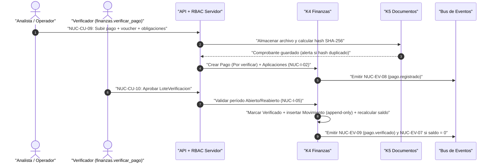

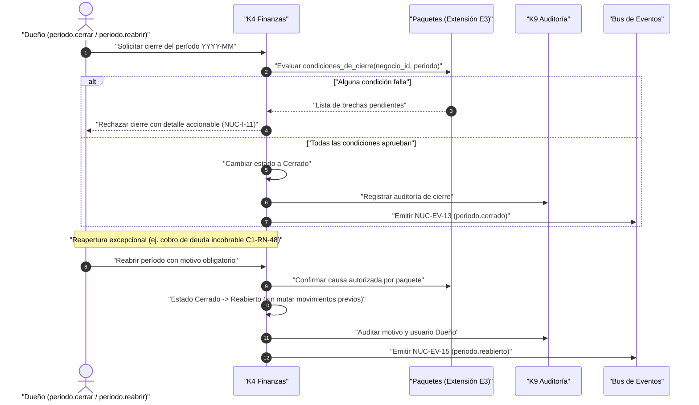

##### Ciclos de vida de `K4`

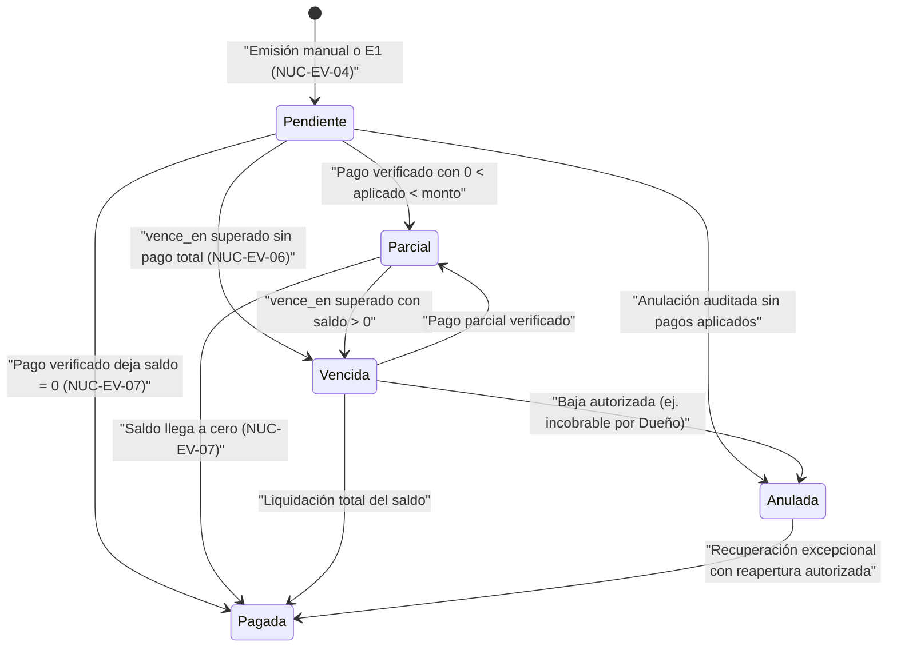

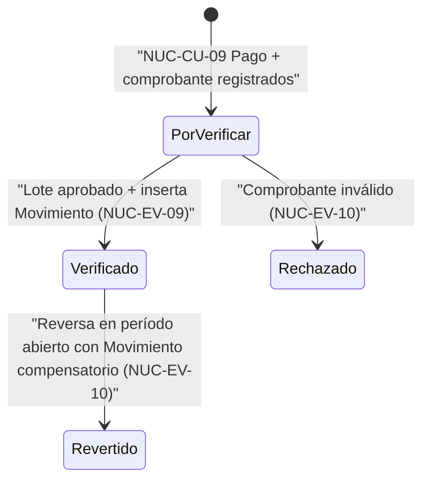

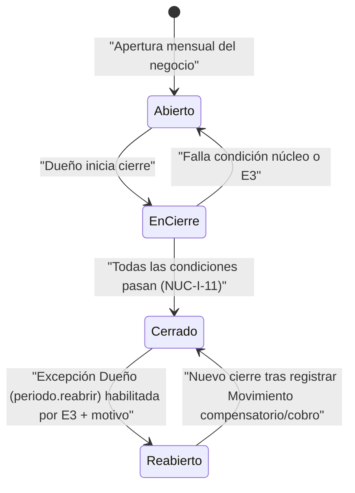

##### Requerimientos funcionales de `K4`

```text
ID:            NUC-RF-18
Nombre:        Cierre de período mensual con condiciones extensibles por paquete y reapertura controlada
Contexto:      K4 Finanzas
Prioridad:     S          Etapa: 2
Origen:        [CONFIRMADO — 13/Nov] NUC-RN-11, C1-RN-48, E3
Descripción:   Permitir al Dueño cerrar mensualmente cada negocio validando precondiciones del núcleo
               (ningún pago en estado Por verificar) y todas las condiciones registradas por paquetes
               activos vía `E3`. Un período `Cerrado` bloquea nuevos movimientos, salvo reapertura
               excepcional `Cerrado -> Reabierto -> Cerrado` autorizada exclusivamente por el Dueño
               cuando una regla del paquete lo habilite y con motivo auditado.
Reglas:        NUC-RN-01, NUC-RN-11, NUC-RN-22, NUC-RN-24
Invariantes:   NUC-I-05, NUC-I-06, NUC-I-11
Casos de uso:  NUC-CU-14
Criterio de aceptación:
  Dado un período `2026-10` con un pago aún `Por verificar` o una condición `E3` incumplida,
  cuando el Dueño intenta cerrar el período,
  entonces el sistema bloquea el cierre listando los pendientes; tras cerrarse, solo el Dueño puede reabrirlo excepcionalmente por causal autorizada dejando bitácora inmutable.
```

```text
ID:            NUC-RF-30
Nombre:        Registro de ingresos y egresos con imputación a centro de costo
Contexto:      K4 Finanzas
Prioridad:     M          Etapa: 1
Origen:        [MAPEO] + [CONFIRMADO] NUC-D-07, NUC-D-08
Descripción:   El sistema debe registrar todo ingreso verificado y egreso aprobado como asientos
               inmutables (`Movimiento`) de solo inserción, clasificados por categoría y asociados
               opcionalmente a un `CentroCosto` (referenciado mediante `RefRegistro`), corrigiendo
               errores únicamente mediante movimientos de reversa.
Reglas:        NUC-RN-01, NUC-RN-15, NUC-RN-27
Invariantes:   NUC-I-04, NUC-I-05, NUC-I-06, NUC-I-14
Casos de uso:  NUC-CU-10, NUC-CU-11, NUC-CU-12
Criterio de aceptación:
  Dado un egreso de `S/ 350.00` aprobado y verificado en período `Abierto`,
  cuando el usuario intenta modificar su monto a `S/ 300.00` directamente,
  entonces el sistema impide la edición y exige al Dueño emitir una reversa y registrar el nuevo asiento.
```

```text
ID:            NUC-RF-31
Nombre:        Gestión unificada de cuentas por cobrar y cuentas por pagar (`Obligacion` y `Pago`)
Contexto:      K4 Finanzas
Prioridad:     M          Etapa: 1–2
Origen:        [MAPEO] + [CONFIRMADO — P8] NUC-D-04, NUC-D-05, NUC-D-06
Descripción:   Permitir registrar obligaciones `por_cobrar` y `por_pagar` (manuales o vía generador `E1`)
               y registrar pagos `recibido` o `entregado` con comprobante adjunto, detección de hash duplicado,
               aplicación a cero, una o varias obligaciones (pagos parciales o acumulados) y verificación
               humana por lote (`E4`), manteniendo eventuales excedentes como saldo a favor (`NUC-I-03`).
Reglas:        NUC-RN-01, NUC-RN-02, NUC-RN-04, NUC-RN-11
Invariantes:   NUC-I-02, NUC-I-03, NUC-I-04, NUC-I-05, NUC-I-14
Casos de uso:  NUC-CU-08, NUC-CU-09, NUC-CU-10
Criterio de aceptación:
  Dado un pago verificado de `S/ 500.00` aplicado a una obligación de `S/ 800.00`,
  cuando se consulta la obligación,
  entonces su estado es `Parcial`, su saldo confirmado es `S/ 300.00` y no se calculan intereses automáticos salvo regla de paquete.
```

```text
ID:            NUC-RF-32
Nombre:        Gestión de cuentas de caja, bancos y billeteras con transferencias y conciliación
Contexto:      K4 Finanzas
Prioridad:     S          Etapa: 2
Origen:        [MAPEO] NUC-D-07, NUC-D-11
Descripción:   Permitir definir cuentas de tesorería (`caja`, `banco`, `billetera`, `inversion`) con su
               moneda, consultar saldos calculados desde `Movimiento`, registrar transferencias entre
               cuentas (pares compensatorios) y ejecutar conciliación periódica contra extractos.
Reglas:        NUC-RN-01, NUC-RN-12, NUC-RN-30
Invariantes:   NUC-I-05, NUC-I-06, NUC-I-08, NUC-I-14
Casos de uso:  NUC-CU-12
Criterio de aceptación:
  Dada una transferencia de `S/ 2,000.00` desde Caja Chica hacia Cuenta Corriente BCP,
  cuando se confirma la operación,
  entonces el sistema inserta simultáneamente un débito de `-2,000.00` y un crédito de `+2,000.00` cuya suma neta en P&L es cero.
```

```text
ID:            NUC-RF-33
Nombre:        Estado de Resultados (P&L) gerencial en base caja por negocio, centro de costo y consolidado
Contexto:      K4 Finanzas / K8 Tablero y Reportes
Prioridad:     S          Etapa: 2
Origen:        [MAPEO] + [CONFIRMADO — NUC-Q-26] NUC-D-10, NUC-Q-15, NUC-Q-34
Descripción:   Generar el P&L mensual y anual sobre base de caja (sumando únicamente movimientos
               verificados de clase `ingreso` y `egreso`, convirtiendo monedas según tipo de cambio
               registrado en cada operación), desagregable por categoría y centro de costo, y consolidado
               para todos los negocios de la organización, mostrando en sección informativa separada las
               cuentas por cobrar y por pagar pendientes del período. Acceso exclusivo con `finanzas.ver_totales`.
Reglas:        NUC-RN-12, NUC-RN-27, NUC-RN-30
Invariantes:   NUC-I-01, NUC-I-04, NUC-I-07, NUC-I-14
Casos de uso:  NUC-CU-15, NUC-CU-22
Criterio de aceptación:
  Dado un mes con `S/ 10,000.00` cobrados verificados, `S/ 2,500.00` en obligaciones vencidas no cobradas,
  y `S/ 1,500.00` en garantías de terceros recibidas,
  cuando el Dueño genera el P&L del mes,
  entonces el ingreso del P&L muestra `S/ 10,000.00` (base caja), excluye los `S/ 1,500.00` de terceros e informa aparte `S/ 2,500.00` por cobrar.
```

```text
ID:            NUC-RF-38
Nombre:        Interfaz activable de comprobantes electrónicos SUNAT (PSE/OSE)
Contexto:      K4 Finanzas
Prioridad:     S          Etapa: Futura por definir (NUC-Q-07 — fuera de Etapas 1 y 2)
Origen:        [MAPEO] NUC-Q-07, NUC-RN-26
Descripción:   Proveer en el núcleo un puerto/adaptador desacoplado de emisión de comprobantes
               electrónicos (boleta y factura) mediante proveedor autorizado (PSE/OSE), activable por
               negocio cuando sea requerido legalmente. En Etapas 1–2 permanece deshabilitado sin
               impactar la emisión de recibos internos PDF (`NUC-RF-35`).
Reglas:        NUC-RN-25, NUC-RN-26
Invariantes:   NUC-I-12, NUC-I-14
Casos de uso:  NUC-CU-10
Criterio de aceptación:
  Dado un negocio piloto en Etapa 1-2 sin adaptador SUNAT activado,
  cuando se verifica un pago,
  entonces el núcleo registra el movimiento y emite el recibo PDF interno sin exigir credenciales ni conexión PSE/OSE.
```

```text
ID:            NUC-RF-39
Nombre:        Gestión de fondos de terceros fuera del Estado de Resultados (P&L)
Contexto:      K4 Finanzas
Prioridad:     S          Etapa: 2
Origen:        [INFERIDO C1/C2/C3] NUC-D-09, NUC-RN-27
Descripción:   Permitir registrar recepciones, custodias, devoluciones y aplicaciones de dinero ajeno
               (garantías de alquiler, primas, gastos suplidos, pauta publicitaria) como clase de
               movimiento `fondo_terceros` sin categoría de ingreso o egreso, manteniéndolos visibles en
               saldos de cuenta y separados del P&L por construcción.
Reglas:        NUC-RN-01, NUC-RN-27
Invariantes:   NUC-I-05, NUC-I-07, NUC-I-14
Casos de uso:  NUC-CU-13
Criterio de aceptación:
  Dada una garantía de `S/ 3,000.00` recibida y verificada como `FondoTerceros`,
  cuando se consulta la cuenta bancaria y el P&L del mes,
  entonces la cuenta refleja `+S/ 3,000.00` en tesorería y el P&L refleja `S/ 0.00` de ingreso.
```

---

#### 3.2.5 `K5` — Documentos

**Responsabilidad:** Centralizar archivos adjuntos asociados mediante `RefRegistro` polimórfico a cualquier entidad del núcleo o paquete, garantizando almacenamiento privado, trazabilidad por período, protección de datos sensibles (`D4`), retención mínima de 10 años (`NUC-RN-29`) y generación de documentos PDF desde plantillas.

##### Caso de uso de `K5`

- **`NUC-CU-07`: Adjuntar, consultar y generar documentos (Etapa 1–2)**
  - *Actores:* Dueño, Analista.
  - *Flujo principal:* (1) Sube imagen o PDF (`<= 10 MB`) indicando `tipo_documento`, período y entidad destino (`RefRegistro(tipo, id)`). (2) El sistema valida formato permitido y tamaño, calcula `hash_sha256`, marca `sensible` si `TipoDocumento` o `D4` lo exige, calcula `conservar_hasta` si tiene valor tributario/contractual (`>= cierre ejercicio + 10 años`), guarda en almacenamiento privado y registra metadatos. (3) Al consultar (ej. *"todos los vouchers de 2026"*), valida permisos de negocio y sensibilidad antes de entregar el flujo binario. (4) Para recibos/contratos (`NUC-RF-35`), combina plantilla HTML/PDF con datos del registro y guarda copia inmutable del PDF emitido.

##### Requerimientos funcionales de `K5`

```text
ID:            NUC-RF-10
Nombre:        Repositorio polimórfico de documentos con consulta por período y retención
Contexto:      K5 Documentos
Prioridad:     M          Etapa: 1
Origen:        [CONFIRMADO] NUC-D-13, NUC-RN-29
Descripción:   Almacenar imágenes y PDFs (hasta 10 MB) vinculados mediante `RefRegistro` a cualquier
               entidad del núcleo o paquete, indexados por `tipo_documento`, `contacto_id` (si aplica)
               y `periodo`, con cálculo de hash SHA-256, control de acceso privado y bloqueo de eliminación
               hasta `conservar_hasta` (`>= 10 años` para documentos con valor tributario/financiero).
Reglas:        NUC-RN-20, NUC-RN-29
Invariantes:   NUC-I-01, NUC-I-12
Casos de uso:  NUC-CU-07, NUC-CU-09
Criterio de aceptación:
  Dado un voucher PDF con fecha `2026-03-15` vinculado a un pago del inquilino X,
  cuando el usuario filtra documentos del año `2026` por ese contacto,
  entonces recupera el archivo y cualquier intento de borrado físico antes de `2036-12-31` es denegado.
```

```text
ID:            NUC-RF-35
Nombre:        Generación de documentos PDF desde plantillas configurables
Contexto:      K5 Documentos
Prioridad:     S          Etapa: 2
Origen:        [MAPEO] + [CONFIRMADO] C1-RF-52
Descripción:   Renderizar documentos PDF institucionales (recibos de cobranza, estados de cuenta,
               contratos base, presupuestos) a partir de plantillas definidas por la vertical/plantilla
               y archivar automáticamente cada PDF generado como `Documento` con `RefRegistro`.
Reglas:        NUC-RN-12, NUC-RN-24, NUC-RN-30
Invariantes:   NUC-I-01, NUC-I-12
Casos de uso:  NUC-CU-07, NUC-CU-15
Criterio de aceptación:
  Dado un recibo PDF generado para una cuota verificada de un inquilino,
  cuando se solicita su descarga o envío por correo,
  entonces el PDF mantiene el vocabulario del negocio ("Inquilino", "Cuota") y queda guardado en el repositorio del período.
```

```text
ID:            NUC-RF-82
Nombre:        Lectura asistiva de comprobantes (OCR) con confirmación humana
Contexto:      K5 Documentos / K4 Finanzas
Prioridad:     C          Etapa: 3
Origen:        [EQUIPO] NUC-RN-04
Descripción:   Al adjuntar una imagen o PDF de comprobante en `NUC-CU-09`, invocar opcionalmente un
               servicio OCR para prellenar valores sugeridos de monto, fecha y número de operación,
               indicando visualmente su carácter de sugerencia sujeta a confirmación y verificación humana.
Reglas:        NUC-RN-04, NUC-RN-23
Invariantes:   NUC-I-04
Casos de uso:  NUC-CU-09
Criterio de aceptación:
  Dado un voucher procesado por OCR con monto sugerido `S/ 1,200.00`,
  cuando el operador o verificador no ha confirmado el registro ni aprobado el lote,
  entonces el pago permanece en estado `Por verificar` y no crea `Movimiento`.
```

---

#### 3.2.6 `K6` — Colaboración

**Responsabilidad:** Orquestar la coordinación operativa auditable dentro de cada negocio: tareas entre colaboradores con cierre aprobado (`NUC-P-19`), reglas y solicitudes de aprobación (`NUC-P-21`), mensajería interna anclada a registros (`RefRegistro`), tableros de estado configurables (Kanban) y calculadora integrada.

##### Casos de uso de `K6`

- **`NUC-CU-16`: Asignar, ejecutar y aprobar cierre de tareas (`NUC-P-19`, Etapa 1–2)**
  - *Actores:* Dueño o Analista (asignador / responsable).
  - *Flujo principal:* (1) El asignador crea la `Tarea` con título, descripción, responsable, fecha límite, negocio y opcionalmente `RefRegistro`. (2) La tarea inicia en `Pendiente` y emite `NUC-EV-12` (`tarea.asignada`) para notificar al responsable. (3) El responsable pasa la tarea a `En curso` y al terminarla la marca `Por aprobar` pudiendo adjuntar evidencia en `K5`. (4) Quien asignó o el Dueño revisa: si aprueba, pasa a `Cerrada` (`NUC-RN-28`); si devuelve/rechaza la entrega, exige comentario obligatorio y la regresa a `En curso`.
  - *Excepciones:* El responsable nunca puede aprobar el cierre de su propia tarea (`NUC-I-09`). Si el asignador desestima la tarea antes de cerrarse, pasa a `Cancelada`.
- **`NUC-CU-17`: Resolver solicitudes de aprobación (Etapa 2)**
  - *Actores:* Solicitante (Analista) y Aprobador (Dueño según `ReglaAprobacion`).
  - *Flujo principal:* (1) Al ocurrir una acción sujeta a regla (egreso `>=` umbral, descuento, etc.), nace `SolicitudAprobacion` en `Pendiente` y se notifica al cargo aprobador (`NUC-EV-11`). (2) Un usuario distinto al solicitante (`NUC-I-10`) aprueba o rechaza con comentario obligatorio. (3) Al aprobarse, se desbloquea el registro financiero vinculado.
- **`NUC-CU-18`: Conversar mediante mensajes anclados a un registro (Etapa 2)**
  - *Actores:* Dueño y Analista.
  - *Flujo principal:* Sobre cualquier ficha con `RefRegistro` (ej. cuota de Depto 401), publican un `Mensaje` inmutable y consultable, con marca de lectura por destinatario (`leido_por`), reemplazando conversaciones dispersas de WhatsApp.

##### Diagrama de secuencia y ciclos de vida de `K6`

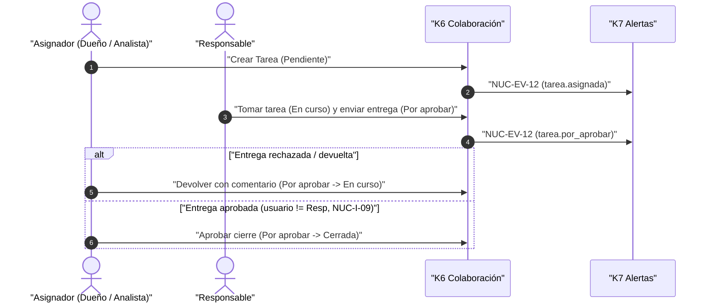

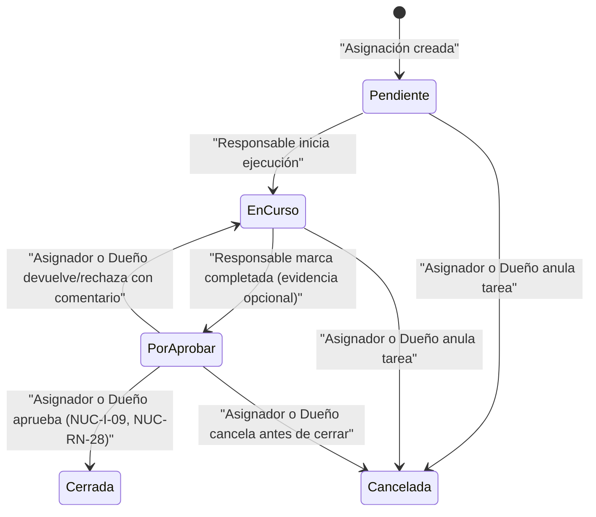

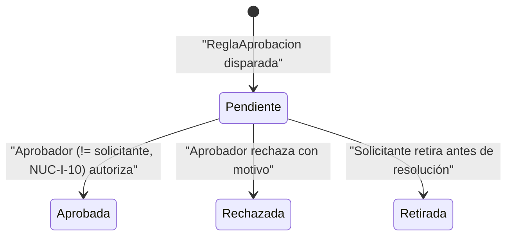

##### Requerimientos funcionales de `K6`

```text
ID:            NUC-RF-06
Nombre:        Mensajería interna auditada anclada a entidades
Contexto:      K6 Colaboración
Prioridad:     S          Etapa: 2
Origen:        [CONFIRMADO] NUC-P-13, NUC-D-13
Descripción:   Proveer hilos de mensajería interna entre Dueño y Analistas vinculados obligatoriamente
               a un negocio y a un `RefRegistro` específico (cuota, gasto, documento, contacto),
               con historial cronológico no editable e indicador de lectura por usuario.
Reglas:        NUC-RN-20, NUC-RN-22
Invariantes:   NUC-I-01
Casos de uso:  NUC-CU-18
Criterio de aceptación:
  Dado un egreso pendiente de aprobación en el Negocio 1,
  cuando el Analista escribe una aclaración en el hilo de ese registro,
  entonces el Dueño ve la notificación no leída enlazada directamente al registro dentro del sistema.
```

```text
ID:            NUC-RF-17
Nombre:        Flujos configurables de aprobación por negocio
Contexto:      K6 Colaboración
Prioridad:     S          Etapa: 2
Origen:        [EQUIPO] + [CONFIRMADO] NUC-RN-15, NUC-I-10
Descripción:   Permitir configurar reglas `ReglaAprobacion` por negocio (por tipo de operación y
               condición de umbral, ej. egreso >= monto X) determinando el cargo aprobador requerido,
               impidiendo técnicamente que quien solicita la aprobación pueda aprobarla.
Reglas:        NUC-RN-15, NUC-RN-22, NUC-RN-25
Invariantes:   NUC-I-01, NUC-I-10
Casos de uso:  NUC-CU-11, NUC-CU-17
Criterio de aceptación:
  Dada una regla que exige aprobación del Dueño para egresos mayores a `S/ 200.00`,
  cuando un Analista registra un gasto de `S/ 450.00`,
  entonces el sistema bloquea su conversión en movimiento hasta que el Dueño apruebe la solicitud.
```

```text
ID:            NUC-RF-36
Nombre:        Motor genérico de estados y tableros Kanban configurables
Contexto:      K6 Colaboración
Prioridad:     S          Etapa: 2
Origen:        [MAPEO] NUC-RF-15
Descripción:   Ofrecer definiciones de máquinas de estado configurables por plantilla (`FlujoEstado`)
               con estados permitidos, transiciones válidas, roles autorizados por transición y vista de
               tablero Kanban arrastrable para entidades operativas de paquetes o motores (ej. limpieza, tickets, leads).
Reglas:        NUC-RN-24, NUC-RN-25
Invariantes:   NUC-I-01
Casos de uso:  NUC-CU-16
Criterio de aceptación:
  Dada una plantilla que define columnas Kanban `Programado -> Reportado -> Cumplido`,
  cuando un usuario sin permiso intenta mover directamente una tarjeta de `Programado` a `Cumplido`,
  entonces el servidor rechaza la transición no declarada.
```

```text
ID:            NUC-RF-40
Nombre:        Asignación de tareas entre colaboradores del negocio
Contexto:      K6 Colaboración
Prioridad:     M          Etapa: 1–2 (Incremento 4; corte final confirmable en NUC-Q-38)
Origen:        [CONFIRMADO — PPT cliente] NUC-P-19, NUC-Q-29
Descripción:   Permitir al Dueño y a los Analistas crear y asignar tareas dentro de un negocio,
               especificando título, descripción, usuario responsable, fecha límite (`vence_en`) y
               vínculo opcional a una entidad mediante `RefRegistro`.
Reglas:        NUC-RN-20, NUC-RN-28
Invariantes:   NUC-I-01, NUC-I-09
Casos de uso:  NUC-CU-16
Criterio de aceptación:
  Dado un usuario autenticado en el Negocio 1,
  cuando asigna la tarea "Subir recibo de luz de mayo" al Analista con vencimiento `2026-05-26`,
  entonces la tarea se crea en estado `Pendiente` asociada al negocio y al asignador.
```

```text
ID:            NUC-RF-41
Nombre:        Estados del ciclo de vida de tarea y notificación automática al responsable
Contexto:      K6 Colaboración
Prioridad:     M          Etapa: 1–2 (Incremento 4)
Origen:        [CONFIRMADO — PPT cliente] (alineado a modelado en §15 #7)
Descripción:   Gestionar el ciclo de estados de toda tarea: `Pendiente`, `En curso`, `Por aprobar`,
               `Cerrada` y `Cancelada` (cuando el asignador o Dueño devuelve/rechaza una entrega en
               revisión, la transición es `Por aprobar -> En curso` con comentario obligatorio).
               Cada asignación o devolución notifica al responsable vía `K7`.
Reglas:        NUC-RN-28
Invariantes:   NUC-I-01, NUC-I-09
Casos de uso:  NUC-CU-16, NUC-CU-21
Criterio de aceptación:
  Dada una tarea recién asignada al usuario B,
  cuando se guarda el registro,
  entonces B recibe notificación en su bandeja (`app`) y al marcar entrega pasa de `En curso` a `Por aprobar`.
```

```text
ID:            NUC-RF-42
Nombre:        Aprobación de cierre de tarea con comentario y evidencia
Contexto:      K6 Colaboración
Prioridad:     M          Etapa: 1–2 (Incremento 4)
Origen:        [CONFIRMADO — PPT cliente] NUC-RN-28
Descripción:   El responsable de una tarea puede marcarla como `Por aprobar` adjuntando evidencia
               documental (`K5`) o notas, pero únicamente quien la asignó o el Dueño pueden aprobar su
               paso a `Cerrada`, o devolverla a `En curso` exigiendo motivo escrito.
Reglas:        NUC-RN-22, NUC-RN-28
Invariantes:   NUC-I-09
Casos de uso:  NUC-CU-16
Criterio de aceptación:
  Dada una tarea en estado `Por aprobar` cuyo responsable es el Analista A y asignador es el Dueño,
  cuando el Analista A intenta aprobar el cierre de su propia tarea,
  entonces el servidor bloquea la acción (`NUC-I-09`); solo el Dueño puede cerrarla o devolverla a `En curso`.
```

```text
ID:            NUC-RF-43
Nombre:        Bandejas "Mis tareas" y "Tareas que asigné" con alerta de vencidas
Contexto:      K6 Colaboración
Prioridad:     S          Etapa: 2
Origen:        [CONFIRMADO — PPT cliente] NUC-P-19
Descripción:   Proveer vistas filtrables de tareas asignadas al usuario actual ("Mis tareas") y tareas
               creadas por él ("Tareas que asigné"), junto con evaluación diaria automática en el
               planificador que alerta al responsable y al asignador cuando `vence_en` expira sin cierre.
Reglas:        NUC-RN-28
Invariantes:   NUC-I-01
Casos de uso:  NUC-CU-16, NUC-CU-19, NUC-CU-20
Criterio de aceptación:
  Dada una tarea en `En curso` con `vence_en` vencido ayer,
  cuando corre la ronda diaria del planificador,
  entonces la tarea aparece resaltada como vencida en ambas bandejas y genera alerta `NUC-EV-12`.
```

```text
ID:            NUC-RF-44
Nombre:        Calculadora integrada accesible globalmente en la interfaz
Contexto:      K6 Colaboración / Utilitario transversal
Prioridad:     C          Etapa: 2
Origen:        [CONFIRMADO — PPT cliente] NUC-Q-30
Descripción:   Incluir una herramienta de calculadora rápida accesible desde la barra superior en
               cualquier pantalla del sistema (aritmética básica en primera versión, extensible mediante
               calculadoras específicas de negocio declaradas por paquetes sin afectar el núcleo).
Reglas:        NUC-RN-24
Invariantes:   NUC-I-14
Casos de uso:  NUC-CU-22
Criterio de aceptación:
  Dado cualquier usuario operando en pantallas de cobro o configuración,
  cuando abre la calculadora integrada,
  entonces puede realizar cálculos sin abandonar ni perder los datos del formulario en curso.
```

```text
ID:            NUC-RF-81
Nombre:        Chat en tiempo real o videollamada interna
Contexto:      K6 Colaboración
Prioridad:     S          Etapa: 3 (postergada respecto a Etapa 1-2; CLI-Q-10)
Origen:        [CONFIRMADO — PPT cliente]
Descripción:   Extender la mensajería interna asíncrona (`NUC-RF-06`) hacia salas de chat en tiempo real
               o videollamadas internas entre miembros autenticados de la organización en Etapa 3.
Reglas:        NUC-RN-20
Invariantes:   NUC-I-01
Casos de uso:  NUC-CU-18
Criterio de aceptación:
  Dado un cliente en Etapas 1-2, se comunica vía mensajes auditados (`NUC-RF-06`); en Etapa 3,
  cuando se habilite chat/videollamada, solo podrán conectarse usuarios de la misma organización.
```

---

#### 3.2.7 `K7` — Alertas y Notificaciones

**Responsabilidad:** Ejecutar la ronda diaria autónoma e idempotente del planificador, evaluar reglas de anticipación/atraso (`ReglaAlerta`), gestionar alertas operativas y su escalamiento al Dueño (`Alerta`) y despachar notificaciones por los canales configurados (`Notificacion`) con reintentos y bitácora.

##### Casos de uso de `K7`

- **`NUC-CU-19`: Atender y escalar bandeja de alertas (Etapa 1)**
  - *Actores:* Analista, Dueño y Planificador.
  - *Flujo principal:* Usuario consulta su bandeja filtrada por negocio/severidad; abre la alerta vinculada vía `RefRegistro` y la marca `Atendida` tras resolver la causa (ej. registrar pago). Si permanece `Abierta` o `Vista` durante `escalar_tras` días, el planificador la marca `Escalada`, notifica al Dueño y emite `NUC-EV-14`.
- **`NUC-CU-20`: Ejecutar ronda diaria de generación de obligaciones y evaluación de atrasos (`NUC-P-23`, Etapa 1)**
  - *Actor principal:* Planificador diario.
  - *Flujo principal:* Por cada `Negocio` en estado `Activo` según su zona horaria (`America/Lima`): (1) Invoca generadores `E1` de sus módulos activos de manera idempotente. (2) Invoca trabajos programados `E6`. (3) Evalúa obligaciones `Por vencer` (`NUC-EV-05`), `Vencida` (`NUC-EV-06`) y tareas vencidas (`NUC-EV-12`) según cada `ReglaAlerta`. (4) Recalcula calificaciones (`E7`) y registra en `TrabajoProgramado` resultado y marca temporal para no duplicar si se reejecuta el mismo día.
- **`NUC-CU-21`: Enviar notificaciones multicanal con reintentos (Etapa 1–3)**
  - *Actor principal:* Planificador / Sistema externo.
  - *Flujo principal:* Por cada `Alerta` o evento suscrito, crea registros `Notificacion` por canal configurado (`app`, `correo` en Etapas 1–2; `SMS` o `WhatsApp` en Etapas 2–3+). Intenta entrega vía adaptador; si falla, incrementa `intentos` y programa reintento; tras agotar reintentos marca `Fallida` dejando visible la alerta en `app`.

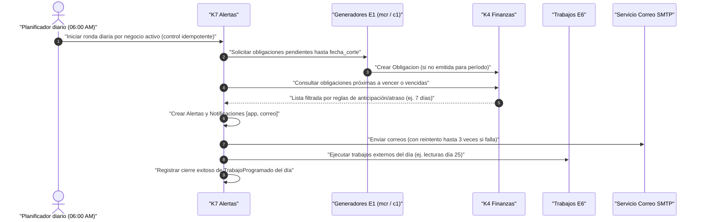

##### Ciclos de vida de `Alerta` y `Notificacion`

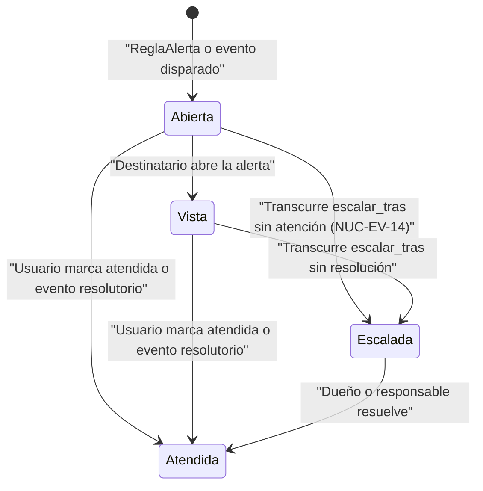

##### Requerimientos funcionales de `K7`

```text
ID:            NUC-RF-07
Nombre:        Bandeja interna de alertas en el sistema y escalamiento configurable
Contexto:      K7 Alertas y Notificaciones
Prioridad:     M          Etapa: 1
Origen:        [CONFIRMADO] NUC-P-14, NUC-Q-27
Descripción:   Proveer una bandeja persistente dentro de la aplicación web donde cada usuario reciba
               alertas generadas por `ReglaAlerta` (vencimientos próximos, atrasos con N días configurables,
               por defecto 7 días en piloto, tareas vencidas y trabajos), con estados `Abierta`, `Vista`,
               `Escalada` y `Atendida`, enlace directo vía `RefRegistro` y ejecución autónoma diaria
               mediante `TrabajoProgramado` idempotente.
Reglas:        NUC-RN-25
Invariantes:   NUC-I-01
Casos de uso:  NUC-CU-19, NUC-CU-20
Criterio de aceptación:
  Dada una cuota con 7 días de atraso y una regla configurada a los 7 días para Analista y Dueño,
  cuando el planificador corre su ronda diaria dos veces en el mismo día,
  entonces emite exactamente una alerta por destinatario y regla sin duplicar registros.
```

```text
ID:            NUC-RF-08
Nombre:        Envío automático de alertas y avisos por correo electrónico
Contexto:      K7 Alertas y Notificaciones
Prioridad:     M          Etapa: 1
Origen:        [CONFIRMADO] NUC-P-14, NUC-Q-27
Descripción:   Despachar notificaciones por correo electrónico mediante adaptador SMTP configurable
               tanto a usuarios internos (alertas de atraso, tareas, aprobaciones) como a contrapartes
               externas (recordatorios de vencimiento, recibos desglosados y saludos), registrando cada
               intento y resultado en `Notificacion`.
Reglas:        NUC-RN-25
Invariantes:   NUC-I-01
Casos de uso:  NUC-CU-20, NUC-CU-21
Criterio de aceptación:
  Dado un fallo temporal del servidor SMTP al enviar un aviso de atraso,
  cuando falla el primer envío,
  entonces `Notificacion` registra el intento fallido, reintenta automáticamente y preserva la alerta en bandeja `app`.
```

```text
ID:            NUC-RF-09
Nombre:        Envío de alertas críticas por canal SMS
Contexto:      K7 Alertas y Notificaciones
Prioridad:     S          Etapa: 2–3 (default aplicado E3 en Ronda 2, NUC-Q-27)
Origen:        [CONFIRMADO — PPT cliente] NUC-Q-27
Descripción:   Incorporar un adaptador de pasarela SMS activable por negocio/regla como canal adicional
               de notificación para alertas de alta prioridad cuando la organización contrate dicho canal.
Reglas:        NUC-RN-25
Invariantes:   NUC-I-01
Casos de uso:  NUC-CU-21
Criterio de aceptación:
  Dado un negocio con canal `SMS` deshabilitado en Etapas 1-2,
  cuando se dispara una `ReglaAlerta`, solo se generan notificaciones en `[app, correo]`;
  si se habilita `SMS` en etapa posterior, las reglas configuradas despachan mediante el adaptador sin modificar `K7`.
```

```text
ID:            NUC-RF-80
Nombre:        Integración con WhatsApp Business para recordatorios y recepción de comprobantes
Contexto:      K7 Alertas / K4 Finanzas
Prioridad:     S          Etapa: 3 (explicación acordada en CLI-Q-10)
Origen:        [CONFIRMADO — PPT cliente] CLI-Q-10, NUC-RN-04
Descripción:   Permitir enviar recordatorios autorizados mediante WhatsApp Business API y recibir imágenes/PDF
               de comprobantes enviadas por contrapartes externas, creándolos siempre como `Pago` en
               estado `Por verificar` vinculados al contacto identificado.
Reglas:        NUC-RN-04, NUC-RN-25
Invariantes:   NUC-I-01, NUC-I-04
Casos de uso:  NUC-CU-09, NUC-CU-21
Criterio de aceptación:
  Dado un comprobante entrante vía WhatsApp desde el teléfono de un contacto registrado en Etapa 3,
  cuando el sistema lo recibe,
  entonces crea un registro `Pago` `Por verificar` sin asentar `Movimiento` hasta la confirmación humana.
```

---

#### 3.2.8 `K8` — Tablero y Reportes

**Responsabilidad:** Ofrecer al `Dueño` la visibilidad ejecutiva unificada de todos sus negocios (*Holding View*), comparando el avance real en caja contra el objetivo mensual y mostrando el indicador de meta específico aportado por cada paquete (`E2`), junto con gráficos de evolución financiera (`NUC-RF-45`) y el P&L consolidado (`NUC-RF-33`). **Totalmente inaccesible para operadores sin `finanzas.ver_totales` (`NUC-RN-30`).**

##### Caso de uso de `K8`

- **`NUC-CU-22`: Visualizar tablero consolidado (*Holding View*) y gráficos de evolución (Etapa 2)**
  - *Actor principal:* Dueño (`finanzas.ver_totales`).
  - *Flujo principal:* (1) Al iniciar sesión en Etapa 2+, el Dueño accede al Holding View con una tarjeta por `Negocio` activo. (2) Cada tarjeta presenta: (a) monto cobrado en el mes (`Movimiento`s verificados de ingreso) frente al `Objetivo` mensual con porcentaje de avance y semáforo (verde si `>=` lo esperado a la fecha; rojo si está debajo), (b) el indicador de meta propio del paquete vía `E2` (en C1: ocupación `unidades ocupadas / alquilables`, verde solo al `100 %`; genérico: variación neta de clientes activos `> 0`; en módulo Inversiones: rendimiento anualizado porcentual ponderado vs. tasa objetivo anual `[PROPUESTO — decisión interna]`), y (c) enlace directo a cuentas pendientes del negocio. (3) Permite abrir el gráfico comparativo de barras de ingresos, egresos y resultado neto por período y consolidado.

##### Requerimientos funcionales de `K8`

```text
ID:            NUC-RF-05
Nombre:        Tablero inicial Holding View con tarjeta por negocio, objetivo y semáforo E2
Contexto:      K8 Tablero y Reportes
Prioridad:     S          Etapa: 2
Origen:        [CONFIRMADO — P6 / NUC-Q-26] NUC-P-13, E2
Descripción:   Mostrar al Dueño una vista consolidada con una tarjeta por negocio que exhiba:
               (1) monto efectivamente cobrado en el mes (base caja) vs. objetivo mensual y semáforo
               (`avance % = cobrado / objetivo * 100`), (2) indicador de meta provisto por el paquete
               vía `E2` (ocupación 100 % en C1; crecimiento de clientes en verticales genéricas) y
               (3) acceso directo al detalle de cuentas por cobrar pendientes y al módulo del negocio.
Reglas:        NUC-RN-12, NUC-RN-18, NUC-RN-24, NUC-RN-30
Invariantes:   NUC-I-01, NUC-I-04, NUC-I-07
Casos de uso:  NUC-CU-22
Criterio de aceptación:
  Dado un negocio inmobiliario con objetivo mensual de `S/ 12,000.00`, `S/ 11,600.00` cobrados verificados
  y 10 de 11 unidades ocupadas,
  cuando el Dueño abre el tablero,
  entonces la tarjeta muestra avance `96.67 %` en rojo, ocupación `90.91 %` en rojo con enlace a la unidad libre y cuentas pendientes;
  si un Analista inicia sesión, esta pantalla y su endpoint le están denegados (`NUC-RN-30`).
```

```text
ID:            NUC-RF-45
Nombre:        Gráfico de barras de evolución de ingresos, egresos y resultado por período
Contexto:      K8 Tablero y Reportes
Prioridad:     S          Etapa: 2
Origen:        [CONFIRMADO — PPT cliente] NUC-D-10
Descripción:   Presentar un gráfico comparativo de barras por períodos mensuales o anuales mostrando
               ingresos cobrados, egresos pagados y resultado neto en base caja, filtrable por negocio
               individual o consolidado de toda la organización (respetando conversión cambiaria histórica
               cuando haya negocios multimoneda). Exclusivo para usuarios con `finanzas.ver_totales`.
Reglas:        NUC-RN-12, NUC-RN-27, NUC-RN-30
Invariantes:   NUC-I-01, NUC-I-07, NUC-I-14
Casos de uso:  NUC-CU-22
Criterio de aceptación:
  Dada una organización con 2 negocios activos y 6 meses cerrados,
  cuando el Dueño consulta el gráfico consolidado en PEN,
  entonces visualiza las barras mensuales de ingreso, egreso y resultado neto excluyendo transferencias y fondos de terceros.
```

---

#### 3.2.9 `K9` — Configuración y Auditoría

**Responsabilidad:** Centralizar parámetros históricos con fecha de vigencia (`Parametro` con `vigente_desde`), gestionar definiciones JSON Schema de campos extensibles (`CampoConfigurable`) y mantener la bitácora inmutable de auditoría (`RegistroAuditoria`).

##### Casos de uso de `K9`

- **`NUC-CU-23`: Configurar objetivos y parámetros con vigencia histórica (Etapa 1–2)**
  - *Actor principal:* Dueño (ámbito organización/negocio) o Admin. plataforma (ámbito plataforma).
  - *Flujo principal:* (1) Selecciona clave de parámetro (días de umbral de alerta, tasa impositiva, UIT tributaria vigente, tasa de depreciación, pesos de calificación o meta mensual). (2) Ingresa nuevo valor y fecha `vigente_desde` (`>= hoy` o fecha de aplicación explícita). (3) El sistema **inserta** una nueva fila histórica sin sobrescribir la anterior (`NUC-RN-01`, `NUC-D-14`) y registra en auditoría.
- **`NUC-CU-24`: Consultar bitácora de auditoría (Etapa 1–2)**
  - *Actor principal:* Dueño (su organización).
  - *Flujo principal:* Filtra eventos por rango de fechas, negocio, usuario, tipo de acción, excepciones o `RefRegistro`, visualizando usuario ejecutor, `acceso_soporte_id` (si aplica), estado `antes`, estado `despues` y marca temporal UTC/local.

##### Requerimientos funcionales de `K9`

```text
ID:            NUC-RF-11
Nombre:        Configuración de parámetros con vigencia temporal histórica
Contexto:      K9 Configuración y Auditoría
Prioridad:     M          Etapa: 1–2
Origen:        [CONFIRMADO] NUC-RN-01, NUC-RN-25, NUC-D-14, NUC-RNF-12
Descripción:   Administrar parámetros globales de plataforma, de organización o de negocio (días de
               umbral de alerta, tasas de impuestos, tabla anual de UIT para cálculos tributarios,
               tasas de referencia, porcentajes de depreciación, pesos de calificación y campos JSONB)
               almacenando cada cambio como registro nuevo con `vigente_desde`, de modo que los
               cálculos retroactivos usen automáticamente el valor vigente en la fecha consultada.
Reglas:        NUC-RN-01, NUC-RN-02, NUC-RN-25
Invariantes:   NUC-I-01, NUC-I-14
Casos de uso:  NUC-CU-23
Criterio de aceptación:
  Dada una UIT 2026 registrada en `Parametro` y una UIT 2027 añadida con `vigente_desde = 2027-01-01`,
  cuando se recalcula un reporte tributario de octubre 2026,
  entonces el cálculo utiliza automáticamente el valor vigente al 2026-10-01 sin verse alterado por el cambio de 2027.
```

```text
ID:            NUC-RF-12
Nombre:        Bitácora inmutable de auditoría de operaciones y excepciones
Contexto:      K9 Configuración y Auditoría
Prioridad:     S          Etapa: 1
Origen:        [EQUIPO] NUC-RN-22, NUC-RNF-03
Descripción:   Registrar automáticamente en `RegistroAuditoria` (solo inserción) toda creación/cambio de
               parámetros, usuarios/permisos, verificaciones o reversas de pago, cierre/reapertura de
               período, aprobación de tareas o solicitudes, intentos de acceso denegados y toda acción
               ejecutada bajo `AccesoSoporte`.
Reglas:        NUC-RN-01, NUC-RN-20, NUC-RN-22
Invariantes:   NUC-I-01, NUC-I-13
Casos de uso:  NUC-CU-24
Criterio de aceptación:
  Dada una reapertura excepcional de período o una edición de permisos de cargo ejecutada por el Dueño,
  cuando se consulta la bitácora de auditoría,
  entonces figura el usuario, fecha/hora exacta, acción, `RefRegistro`, motivo y los valores `antes` y `despues`.
```

---

### 3.3 Requerimientos No Funcionales (`NUC-RNF-01` a `NUC-RNF-23`)

Agrupados en las 5 categorías normativas del núcleo, cada requerimiento define métricas verificables y método de comprobación:

#### 3.3.1 Seguridad y privacidad

| ID | Requerimiento y especificación normativa | Métrica objetiva | Método de verificación |
|----|------------------------------------------|------------------|------------------------|
| **`NUC-RNF-01`** | **Seguridad de acceso y RBAC en servidor:** Contraseñas almacenadas con `Argon2id` (o `bcrypt` factor >= 12); sesiones HTTP con expiración por inactividad y expiración absoluta; toda autorización por acción y ocultamiento de totales (`NUC-RN-30`) se aplica en el servidor. | `100 %` de endpoints privados exigen sesión + permiso; expiración por defecto `<= 8 h` inactividad / `24 h` absoluta; `0` contraseñas en texto claro. | Pruebas de integración en CI invocando cada endpoint sin token, con token expirado y con usuario `Analista` verificando respuesta `HTTP 403` o ausencia de totales. |
| **`NUC-RNF-02`** | **Privacidad y Ley N.º 29733 (Perú):** Custodia protegida de datos personales (DNI, copias de identidad, boletas laborales, teléfonos). Registro de fecha/medio de consentimiento del titular, URLs no públicas para archivos y restricción por rol. | `0` archivos personales accesibles sin cookie/token autenticado válido; `100 %` de formularios de alta con PII capturan indicador de consentimiento. | Prueba de penetración básica sobre rutas de descarga y revisión legal/funcional de formularios y políticas antes de salida a cliente piloto/externo. |
| **`NUC-RNF-14`** | **Aislamiento multi-tenant obligatorio con RLS:** Todas las tablas de negocio llevan `organizacion_id NOT NULL` filtrado en la capa de acceso mediante `FORCE ROW LEVEL SECURITY` en PostgreSQL. | `0` fugas cruzadas entre organizaciones incluso omitiendo `WHERE` manual en consultas SQL de aplicación. | Suite automatizada de "fuga multi-tenant" en CI ejecutando consultas cruzadas entre Org A y Org B contra PostgreSQL real (`S01`). |
| **`NUC-RNF-19`** | **Uso responsable de IA:** El uso de modelos IA (Etapa 3+) requiere consentimiento previo explícito, minimiza/anonimiza datos personales y prohíbe publicar cambios sin revisión y firma humana (`NUC-RN-23`). | `0` registros PII de contrapartes enviados al proveedor IA por defecto; `100 %` de propuestas IA registran usuario aprobador. | Inspección de payloads salientes del adaptador IA en pruebas automatizadas y auditoría de tabla de propuestas. |
| **`NUC-RNF-21`** | **Sensibilidad declarada por paquete (`D4`):** Los paquetes pueden etiquetar campos o tipos de documento como sensibles (ej. salud, credenciales) aplicando cifrado adicional en reposo y permisos dedicados de lectura. | `100 %` de campos/archivos marcados `D4` cifrados en reposo (AES-256) y ocultos salvo permiso explícito. | Pruebas de lectura con roles estándar y verificación del almacenamiento cifrado en base de datos/disco. |

#### 3.3.2 Integridad y datos

| ID | Requerimiento y especificación normativa | Métrica objetiva | Método de verificación |
|----|------------------------------------------|------------------|------------------------|
| **`NUC-RNF-03`** | **Inmutabilidad histórica y bloqueo de períodos:** Registros históricos de tarifas, movimientos verificados, auditoría y períodos cerrados no admiten edición ni borrado destructivo (`NUC-RN-01`, `NUC-RN-11`). | `0` operaciones `UPDATE` de importe o `DELETE` permitidas sobre `nuc_movimiento` y `Cerrado`; `100 %` de excepciones auditadas. | Pruebas en CI intentando mutar/borrar movimientos verificados o insertar en período cerrado (`S07`) validando rechazo de dominio y trigger SQL. |
| **`NUC-RNF-10`** | **Precisión aritmética monetaria:** Todos los importes y tipos de cambio emplean tipo decimal exacto (`NUMERIC(14,2)` para montos, `NUMERIC(10,6)` para tipos de cambio/factores), prohibiendo `float`/`double`/`REAL`, con redondeo `HALF_UP` a 2 decimales por moneda. | Error de redondeo acumulado `= 0.00` en sumas, aplicaciones parciales, transferencias y prorrateos. | Pruebas unitarias de aritmética monetaria con casos borde (fracciones periódicas, pagos parciales y conversión PEN/USD). |
| **`NUC-RNF-20`** | **Portabilidad de datos en formatos abiertos:** El cliente puede exportar íntegramente sus registros estructurados y archivos adjuntos sin bloqueo propietario (`NUC-RF-20`). | Exportación completa en CSV/JSON UTF-8 + archivos originales + manifiesto SHA-256 en `< 60 s` para organizaciones estándar (`<= 500` unidades). | Prueba automatizada de exportación e integridad de hashes sobre dataset sintético. |
| **`NUC-RNF-22`** | **Retención legal de 10 años:** Toda información con valor contable y tributario (ingresos, egresos, comprobantes, vouchers, reportes fiscales/P&L) se conserva mínimo **10 años** (`conservar_hasta`) y no puede eliminarse físicamente antes de ese plazo, aun tras la baja del negocio (`NUC-RN-29`, `NUC-Q-28`). | `0` registros financieros/tributarios eliminables físicamente antes de `cierre_ejercicio + 10 años`. | Prueba automatizada intentando depuración física en `NUC-P-18` antes de `conservar_hasta` verificando bloqueo a nivel de servicio y BD. |

#### 3.3.3 Operación

| ID | Requerimiento y especificación normativa | Métrica objetiva | Método de verificación |
|----|------------------------------------------|------------------|------------------------|
| **`NUC-RNF-04`** | **Disponibilidad y respaldos automáticos:** Respaldos automáticos diarios cifrados de PostgreSQL y almacenamiento de archivos hacia copia externa verificada, con procedimiento documentado de restauración. | **RPO `<= 24 h`** (copia diaria automatizada); **RTO `<= 4 h`** para restauración completa; prueba de restauración exitosa al menos **1 vez por trimestre**. | Ejecución programada de job de respaldo con alerta de fallo y simulacro trimestral documentado en entorno staging. |
| **`NUC-RNF-09`** | **Confiabilidad e idempotencia del planificador:** La ronda diaria (`K7` + `E1` + `E6`) corre automáticamente en el servidor sin requerir sesiones humanas abiertas, registra ejecución por negocio/día y reintenta notificaciones fallidas. | `100 %` de ejecuciones idempotentes (reintento en el mismo día produce `0` obligaciones o alertas duplicadas); hasta `3` reintentos SMTP con backoff. | Pruebas de integración ejecutando el scheduler múltiples veces para la misma fecha lógica y simulando caída SMTP (`S11`). |
| **`NUC-RNF-17`** | **Equidad de carga entre organizaciones:** Controles de tasa (*rate limiting*), cuotas de almacenamiento y colas por organización en servidores compartidos para que un cliente intensivo no degrade a los demás. | Límite configurable de peticiones por organización/minuto, tamaño de lote de exportación y cuota de archivo, manteniendo `p95 < 2 s` en organizaciones vecinas bajo carga. | Prueba de carga sintética simulando ráfaga en Org A mientras se miden tiempos de respuesta en Org B. |
| **`NUC-RNF-18`** | **Observabilidad multi-tenant sin exposición de PII:** Logs estructurados, métricas de latencia/error y trazas etiquetadas por `organizacion_id`, `negocio_id` y `correlation_id`, enmascarando nombres, documentos, contraseñas y montos sensibles. | `100 %` de errores 5xx y jobs diarios trazables por `correlation_id`; `0` contraseñas, DNI o vouchers impresos en logs planos. | Revisión automática de logs en pruebas de integración comprobando ausencia de PII y presencia de `organizacion_id`. |
| **`NUC-RNF-23`** | **Despliegue en servidores operados por el equipo:** La plataforma corre en servidores administrados directamente por el equipo (no en hardware del cliente ni PaaS opaco sin control de datos, `NUC-Q-32`), centralizando respaldos, cron, SMTP y actualizaciones. | `100 %` de componentes desplegables de forma reproducible (contenedores/systemd + IaC/scripts versionados) en servidor Linux administrado por el equipo. | Despliegue reproducible limpio en servidor de pruebas y verificación de arranque de backend, PostgreSQL, scheduler y SMTP. |

#### 3.3.4 Producto y evolución

| ID | Requerimiento y especificación normativa | Métrica objetiva | Método de verificación |
|----|------------------------------------------|------------------|------------------------|
| **`NUC-RNF-05`** | **Escalabilidad modular y volumen:** Arquitectura de un solo código base capaz de crecer a N negocios/rubros y soportar cientos de unidades o miles de obligaciones por organización sin rediseñar el esquema. | Degradación `< 15 %` en latencia `p95` al escalar de `50` a `500` unidades/contratos y `10,000` movimientos por organización. | Benchmark con datos sintéticos sobre PostgreSQL paginado e indexado por `(organizacion_id, negocio_id, periodo)`. |
| **`NUC-RNF-11`** | **Mantenibilidad:** Código fuente versionado en Git con convenciones limpias, cobertura automatizada sobre cálculos financieros, invariantes y reglas críticas, y documentación sincronizada. | Cobertura `>= 85 %` en lógica de dominio de `K4` (saldos, reversas, cierres) y `mcr` (tarifas históricas); pipeline CI verde en cada PR. | Ejecución obligatoria de suite de pruebas y linters en CI antes de cada merge a `main`. |
| **`NUC-RNF-12`** | **Configurabilidad sin cambios de código:** Impuestos, UIT (uso tributario), umbrales de alertas, tasas de depreciación, objetivos y pesos de calificación viven en `Parametro` (`K9`) y plantillas (`K1`), nunca *hardcodeados*. | `0` constantes tributarias o umbrales de negocio fijos en código fuente; `100 %` leídos desde `K9` según `vigente_desde`. | Inspección de código y pruebas cambiando parámetros entre fechas de vigencia sin reiniciar ni recompilar. |
| **`NUC-RNF-15`** | **Extensibilidad con frontera unidireccional:** Agregar un motor o paquete de clúster no modifica archivos dentro de `nucleo/`. Las dependencias apuntan únicamente de capas externas hacia el núcleo. | `0` importaciones detectadas desde `nucleo/` hacia `motores/`, `paquetes/` o `modulos/`. | Regla estática automática de dependencias (*architecture/import linter*) ejecutada en CI (`S15`). |
| **`NUC-RNF-16`** | **Versionado de plantillas y migraciones reversibles:** Toda plantilla y módulo posee versión SemVer; cada negocio registra qué versión ejecuta y las migraciones de esquema permiten rollback controlado. | `100 %` de cambios de esquema DDL con script `up` y `down` probado; `100 %` de negocios con versión trazable en `Activacion`. | Prueba en CI aplicando migración `up`, `down` y re-aplicación `up` en base limpia. |

#### 3.3.5 Uso y entrega

| ID | Requerimiento y especificación normativa | Métrica objetiva | Método de verificación |
|----|------------------------------------------|------------------|------------------------|
| **`NUC-RNF-06`** | **Usabilidad y simplicidad operativa:** Interfaz intuitiva en español para usuarios no técnicos, formato monetario peruano (`S/` y `US$`) y flujo de cobro con comprobante optimizado. | Flujo estándar de registrar cobro + subir voucher + aplicar a cuota completado en **`<= 3` pasos** y **`<= 60 s`** por usuario piloto entrenado. | Prueba de usabilidad cronometrada sobre prototipo/sistema con usuarios tipo analista y dueño. |
| **`NUC-RNF-07`** | **Portabilidad Web (E1–E2) y Escritorio (E3+):** Aplicación web responsiva accesible desde navegadores modernos en laptop y celular para el piloto y empresas pequeñas (`NUC-Q-33`); empaquetable como app de escritorio (Electron/Tauri) consumiendo la misma UI y backend para empresas medianas/grandes (`NUC-Q-31` postergado). | Soporte verificado en Chrome/Edge/Firefox/Safari móvil actuales y anchos `360 px`–`1920 px` sin scroll horizontal roto. | Pruebas de visualización responsiva (desktop y móvil) en los flujos de Etapa 1–2. |
| **`NUC-RNF-08`** | **Rendimiento interactivo:** Carga ágil de vistas operativas principales y tablero con los volúmenes esperados de operación multi-tenant. | Tiempo de respuesta servidor+render **`< 2.0 s` (`p95`)** para listados paginados, tablero Holding View y P&L hasta `50` usuarios concurrentes / `500` unidades. | Pruebas de rendimiento automatizadas sobre base de datos poblada con volumen de referencia. |
| **`NUC-RNF-13`** | **Almacenamiento de comprobantes y anexos:** Soporte de formatos de imagen (JPG, PNG, WEBP) y PDF para vouchers, DNI y contratos organizados por negocio, contacto/centro de costo y período. | Tamaño máximo por archivo **`10 MB`**; verificación de MIME real (magic bytes) y generación de hash SHA-256 en `< 500 ms`. | Pruebas de subida con archivos válidos de 10 MB, archivos de 10.1 MB rechazados y archivos renombrados inválidos rechazados. |

---

### 3.4 Restricciones de Diseño y Reglas Arquitectónicas

1. **Monolito modular sobre un único código base:** los directorios `nucleo/`, `motores/`, `paquetes/` y `modulos/` conviven en un mismo repositorio y proceso de backend, comunicándose por interfaces públicas explícitas y bus de eventos post-commit.
2. **Nomenclatura en español:** entidades, tablas físicas con prefijo de módulo (`nuc_`, `mcr_`, `c1_`, `inv_`), campos estándar (`organizacion_id`, `negocio_id`, `creado_en`, `vigente_desde`) y mensajes de dominio se escriben en español consistente con el dominio del negocio *(descartando borradores previos en inglés)*.
3. **Barrera doble de aislamiento multi-tenant:** además del filtro obligatorio en el ORM/repositorio de aplicación, PostgreSQL aplica `ENABLE ROW LEVEL SECURITY` y `FORCE ROW LEVEL SECURITY` en todas las tablas con `organizacion_id`, evaluando `organizacion_id = current_setting('app.organizacion_id')::uuid`.
4. **Libro mayor de solo inserción (`nuc_movimiento`):** protegido por reglas de servicio y trigger de base de datos que rechazan `UPDATE` de columnas financieras/fechas y `DELETE`. Toda corrección se ejecuta mediante un nuevo registro con `revierte_a` que solo puede referenciarse una vez (`NUC-I-06`).
5. **Vocabulario genérico en capa 1:** el núcleo prohíbe términos de vertical como `departamento`, `inquilino`, `paciente`, `obra` o `plato` en sus esquemas, endpoints y clases de código; dichos términos viven únicamente en Capa 3 y Capa 4.

### 3.5 Atributos Lógicos de Datos y Cumplimiento de Privacidad

- **Referencia polimórfica (`RefRegistro`):** valor compuesto `(tipo, id)` validado contra el catálogo `D1` registrado por el núcleo (`nuc.*`), motores (`mcr.*`) o paquetes (`c1.*`). Permite anexar documentos, tareas, mensajes, alertas, auditoría y centros de costo sin acoplar llaves foráneas del núcleo hacia paquetes.
- **Campos configurables sin anti-patrón EAV:** los campos adicionales definidos por plantilla (`D3`) se almacenan en columna `campos_adicionales JSONB` validada contra un JSON Schema versionado en el servidor antes de persistir, permitiendo indexación GIN selectiva y consultas tipadas.
- **Vigencia temporal de parámetros y tarifas (`NUC-D-14`):** todo parámetro con impacto histórico (`Parametro`) conserva `vigente_desde`; ninguna actualización destruye el valor pasado.
- **Conciliación entre Ley N.º 29733 y retención tributaria de 10 años (`NUC-RN-29` vs. derechos ARCO):** ante una solicitud de cancelación/baja de datos personales o salida de un cliente (`NUC-RF-20`), el sistema **conserva bloqueados e inalterables hasta `conservar_hasta` (`>= 10 años`)** los comprobantes, movimientos, obligaciones y reportes tributarios exigidos por ley, mientras anonimiza o elimina únicamente datos no tributarios de contacto/marketing una vez cumplido el flujo de baja.

---

## Apéndice A. Modelo de Dominio Conceptual, Decisiones, Reglas, Invariantes y Glosario

### A.1 Diagramas de clases conceptuales del núcleo

#### A.1.1 Contextos `K1 Plataforma`, `K2 Identidad` y `K3 Directorio`

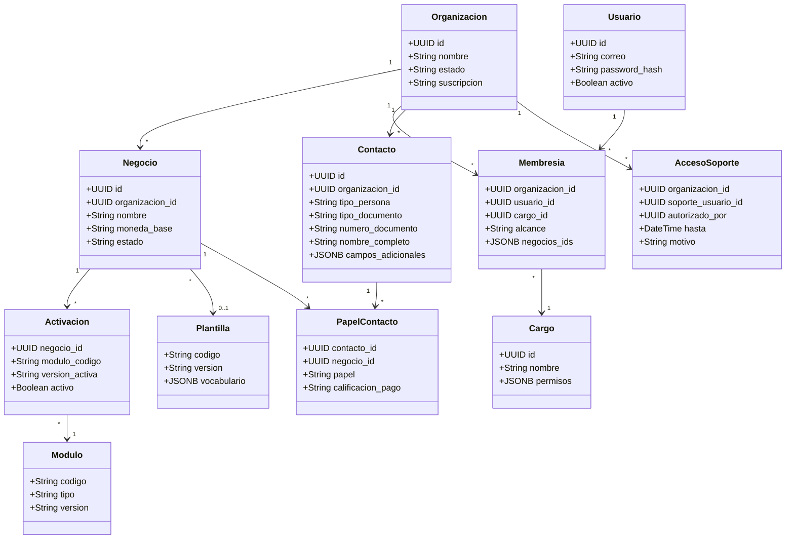

#### A.1.2 Contexto Central `K4 Finanzas`

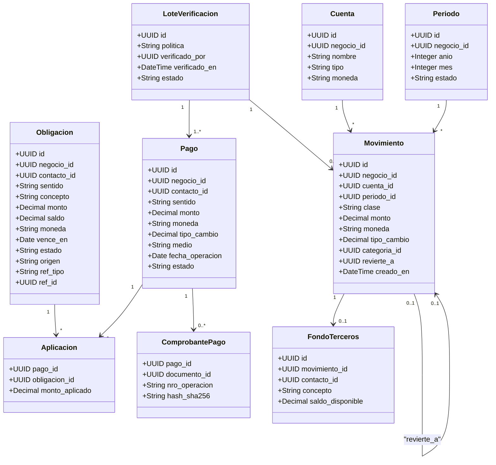

#### A.1.3 Contextos `K5 Documentos`, `K6 Colaboración`, `K7 Alertas` y `K9 Configuración/Auditoría`

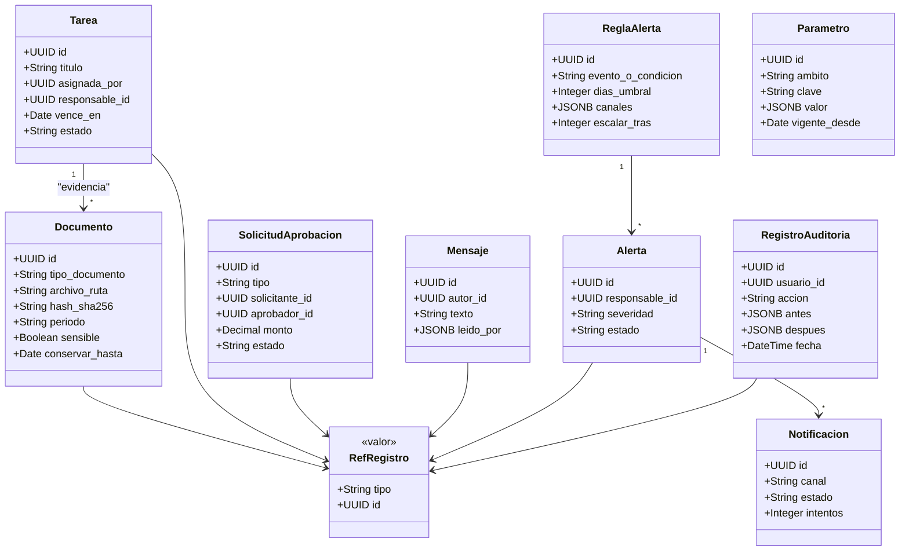

### A.2 Decisiones de diseño estructurales (`NUC-D-01` a `NUC-D-14`)

| ID | Decisión | Justificación |
|----|----------|---------------|
| `NUC-D-01` | 1 `Plantilla` + N `Activacion`es por `Negocio` | Permite combinar módulos y versionar plantillas sin afectar negocios existentes. |
| `NUC-D-02` | `Usuario` global + `Membresia` por `Organizacion` | Un usuario puede trabajar en distintos clientes sin duplicar login y sin cruzar datos. |
| `NUC-D-03` | Permisos granulares por acción agrupados en `Cargo` | Desacopla privilegios de nombres fijos de vertical ("Analista" vs. "Recepción"). |
| `NUC-D-04` | `Obligacion` unificada para CxC y CxP (`sentido`) | Misma maquinaria de vencimientos, alertas, saldos y aplicaciones en los 6 clústeres. |
| `NUC-D-05` | `Pago` separado de `Obligacion` mediante `0..*` `Aplicacion`es | Soporta pagos parciales, pagos de varios períodos juntos y ventas al contado (`0` aplicaciones). |
| `NUC-D-06` | Verificación por `LoteVerificacion` (`por_pago` o `por_cierre_de_caja`) | Mantiene responsabilidad humana (`NUC-RN-04`) tanto en alquileres como en alto volumen. |
| `NUC-D-07` | Todo dinero real confirmado termina en `Movimiento` | Tablero, P&L y conciliación se calculan desde una sola fuente agnóstica al rubro. |
| `NUC-D-08` | `Movimiento` de solo inserción corregible únicamente con reversas | Preserva historia intacta y permite corregir errores en período abierto sin alterar el pasado. |
| `NUC-D-09` | `FondoTerceros` como clase de movimiento sin categoría de ingreso/egreso | Garantiza exclusión matemática del P&L (`NUC-RN-27`) por construcción de esquema. |
| `NUC-D-10` | P&L gerencial calculado en base de caja (movimientos verificados) | Responde a la métrica real del negocio ("lo efectivamente cobrado"), con cartera pendiente informada aparte. |
| `NUC-D-11` | Moneda base por negocio + moneda y tipo de cambio por operación | Soporta operación simultánea en soles (`PEN`) y dólares (`USD`) con historia cambiaria exacta. |
| `NUC-D-12` | `Periodo` mensual independiente por negocio | Un negocio con retraso documental no bloquea el cierre de los demás negocios de la organización. |
| `NUC-D-13` | `RefRegistro(tipo, id)` polimórfico | Ancla documentos, tareas, mensajes, alertas y centros de costo sin acoplar tablas del núcleo a paquetes. |
| `NUC-D-14` | `Parametro` histórico con `vigente_desde` | Impide que un cambio de tasa/UIT/umbral altere cálculos retroactivos de meses ya cerrados. |

### A.3 Reglas de negocio universales (`NUC-RN-01` a `NUC-RN-30`)

| ID | Regla universal | Origen |
|----|-----------------|--------|
| `NUC-RN-01` | **Nada se borra:** montos históricos y parámetros no se sobrescriben ni eliminan; un cambio crea registro nuevo con fecha de vigencia. | `[CONFIRMADO]` |
| `NUC-RN-02` | Toda obligación/cálculo toma el **valor vigente** del parámetro o tarifa en su período (`vigente_desde <= inicio del período`). | `[INFERIDO]` |
| `NUC-RN-04` | El sistema **no decide solo** si un comprobante es válido; lo verifica una persona. OCR e IA solo sugieren. | `[CONFIRMADO]` |
| `NUC-RN-11` | Un período `Cerrado` no admite cambios; solo cierra si cumple condiciones núcleo + `E3`, salvo reapertura excepcional controlada. | `[CONFIRMADO]` |
| `NUC-RN-12` | El operador ve montos individuales necesarios para operar, pero **no** ve ganancias, rendimientos, valorizaciones ni totales de negocio. | `[CONFIRMADO]` |
| `NUC-RN-13` | Los usuarios operativos pueden ser N; el cargo y sus permisos determinan privilegios. | `[CONFIRMADO]` |
| `NUC-RN-15` | Los egresos de un operador pueden exigir **aprobación del dueño** según regla configurable. | `[CONFIRMADO]` |
| `NUC-RN-18` | Una organización puede administrar N negocios, cada uno con objetivo mensual. | `[CONFIRMADO]` |
| `NUC-RN-20` | **Aislamiento total:** ningún dato o consulta cruza entre organizaciones. | `[EQUIPO]` |
| `NUC-RN-21` | Búsquedas de personas por documento limitadas a la organización; no se comparte morosidad entre clientes. | `[CONFIRMADO — 13/Nov]` |
| `NUC-RN-22` | Toda excepción (reapertura, reversa) y todo acceso de soporte queda en bitácora de auditoría. | `[INFERIDO]` |
| `NUC-RN-23` | La IA no publica configuraciones ni actúa sobre datos reales sin confirmación humana. | `[EQUIPO]` |
| `NUC-RN-24` | Las reglas de un rubro van en su paquete o plantilla, **nunca** dentro del núcleo. | `[EQUIPO]` |
| `NUC-RN-25` | Importes, impuestos, umbrales y pesos son parámetros configurables, no valores fijos en código. | `[CONFIRMADO]` |
| `NUC-RN-26` | El sistema calcula y reporta impuestos; no presenta declaraciones ante SUNAT. | `[CONFIRMADO]` |
| `NUC-RN-27` | El dinero de terceros (garantías, primas, suplidos, pauta) **no es ingreso** ni entra al P&L. | `[INFERIDO]` |
| `NUC-RN-28` | Una tarea pasa a `Cerrada` únicamente cuando la aprueba quien la asignó o el Dueño. | `[CONFIRMADO — PPT]` |
| `NUC-RN-29` | Datos financieros/tributarios se conservan mínimo **10 años** desde cierre de ejercicio; antes solo se archivan. | `[CONFIRMADO — PPT]` |
| `NUC-RN-30` | **Sin agregados para el operador:** ninguna pantalla, listado o exportación visible para rol sin `finanzas.ver_totales` incluye sumas, subtotales ni conteos monetarios. | `[CONFIRMADO — P9]` |

#### Cómo parametriza cada clúster las variaciones (`E2`, `E3`, `E4`)

| Regla | `C1` Activos | `C2` Comercial | `C3` Proyectos | `C4` Citas | `C5` Técnico | `C6` Comercio |
|-------|--------------|----------------|----------------|-----------|--------------|---------------|
| **Verificación (`E4`)** | Por pago | Por pago | Por pago | Por cierre de caja diario | Por OT o caja | Por cierre de turno |
| **Centro de costo (`D1`)** | Unidad / Inmueble | Expediente | Proyecto / Cliente | Sede / Profesional | OT / Contrato | Tienda / Línea |
| **Cierre (`E3`)** | Cuotas y prorrateos conciliados | Comisiones liquidadas | Horas y gastos cargados | Cajas cerradas | OT facturadas | Cajas y Kardex conciliados |
| **Indicador tablero (`E2`)** | Alquiler cobrado + Ocupación 100 % | Margen / Forecast + Clientes | Facturado / Margen + Clientes | Caja / MRR + Clientes | Facturado + Clientes | Ventas / Margen + Clientes |

### A.4 Invariantes formales del sistema (`NUC-I-01` a `NUC-I-14`)

*(Renombrados desde `INV-01..14` para eliminar colisión con el prefijo `INV-` del módulo de Inversiones).*

| ID | Invariante | Enforcement obligatorio |
|----|------------|------------------------|
| **`NUC-I-01`** | Ningún registro perteneciente a una `Organizacion` es visible, modificable o inferible desde otra. | PostgreSQL `FORCE RLS` + pruebas de fuga en CI (`S01`). |
| **`NUC-I-02`** | Para todo `Pago`, la suma de `monto_aplicado` en sus `Aplicacion`es nunca excede `pago.monto`. | Validación transaccional + constraint/trigger BD. |
| **`NUC-I-03`** | El `saldo` de una `Obligacion` nunca es negativo (`saldo >= 0`); cualquier excedente permanece como saldo a favor no aplicado. | Validación de servicio y `CHECK (saldo >= 0)`. |
| **`NUC-I-04`** | Un `Pago` en estado `Por verificar` o `Rechazado` **no** genera `Movimiento` ni reduce el saldo confirmado ni entra al P&L/tablero. | Único servicio creador de `Movimiento` en `NUC-CU-10`. |
| **`NUC-I-05`** | Un `Movimiento` solo puede insertarse en un `Periodo` cuyo estado sea `Abierto` o `Reabierto`. | Validación en servicio de dominio + verificación en BD. |
| **`NUC-I-06`** | Un `Movimiento` nunca se modifica ni se elimina; puede revertirse **como máximo una vez** (`UNIQUE` parcial sobre `revierte_a`). | Trigger SQL anti-UPDATE/DELETE + índice único en `revierte_a`. |
| **`NUC-I-07`** | Todo `Movimiento` de clase `fondo_terceros` o `transferencia` tiene `categoria_id IS NULL` y queda excluido del P&L. | `CHECK` en BD + filtro fijo en cálculo de P&L. |
| **`NUC-I-08`** | Toda transferencia entre cuentas genera exactamente dos `Movimiento`s vinculados cuya suma algebraica en la misma moneda es `0.00`. | Transacción atómica en `NUC-CU-12`. |
| **`NUC-I-09`** | El `responsable_id` de una `Tarea` no puede ejecutar la aprobación de su propio cierre a `Cerrada`. | Validación en servidor (`usuario_actual != tarea.responsable_id`). |
| **`NUC-I-10`** | El `solicitante_id` de una `SolicitudAprobacion` no puede resolver su propia solicitud. | Validación en servidor (`usuario_actual != solicitud.solicitante_id`). |
| **`NUC-I-11`** | Un `Periodo` pasa a `Cerrado` únicamente si el 100 % de las validaciones del núcleo y de las extensiones `E3` activas retornan aprobado. | Orquestador transaccional en `NUC-CU-14`. |
| **`NUC-I-12`** | Todo `Documento` o registro financiero/tributario permanece protegido contra eliminación física hasta superar `conservar_hasta` (`>= 10 años`). | Guardas en servicio y políticas de retención (`NUC-RN-29`). |
| **`NUC-I-13`** | Todo `AccesoSoporte` requiere autorización explícita del `Dueño`, fecha fin `hasta` definida y registro en auditoría. | Constraints NOT NULL + validación temporal por petición. |
| **`NUC-I-14`** | Todo cálculo monetario usa tipo decimal exacto (`NUMERIC`) y redondeo estándar definido por moneda, jamás coma flotante binario. | Tipado estricto en BD y capa de aplicación (`Decimal`). |

### A.5 Glosario mínimo del núcleo

| Término | Definición normativa |
|---------|----------------------|
| **Núcleo (Capa 1)** | Funcionalidad siempre activa compartida por todos los negocios de la plataforma. |
| **Motor (Capa 2)** | Capacidad transversal activable por clústeres que la requieren (ej. cobro recurrente). |
| **Paquete de clúster (Capa 3)** | Código especializado compartido por los negocios de un mismo clúster (`C1`–`C6`). |
| **Plantilla de vertical (Capa 4)** | Conjunto versionado de metadatos que adapta un paquete y el núcleo a un rubro concreto. |
| **Organización** | Cliente titular en la plataforma y frontera absoluta de aislamiento multi-tenant. |
| **Negocio** | Unidad operativa independiente dentro de una organización, con plantilla, moneda, metas y períodos propios. |
| **Obligación** | Compromiso financiero por cobrar o por pagar con fecha de vencimiento y saldo calculado. |
| **Pago / Aplicación** | Desembolso/recaudo real con evidencia y su imputación parcial o total sobre `0..*` obligaciones. |
| **Movimiento** | Asiento inmutable en cuenta de tesorería; única fuente de verdad del tablero y P&L. |
| **Lote de verificación** | Agrupación de uno o varios pagos que confirma una persona autorizada (`E4`). |
| **Fondo de terceros** | Dinero custodiado perteneciente a terceros (garantías, primas, suplidos), fuera de ingresos propios. |
| **Período** | Mes contable por negocio con candado de cierre y reapertura excepcional auditada. |
| **RefRegistro** | Identificador polimórfico `(tipo, id)` hacia cualquier entidad registrada por `D1`. |
| **Holding View** | Tablero consolidado exclusivo del `Dueño` con una tarjeta de desempeño por negocio. |

---

## Apéndice B. Matriz de Trazabilidad

| Objetivo | Contexto | Caso(s) de uso | Requerimiento(s) | Regla(s) | Invariante(s) | Validación (Ap. C) |
|----------|----------|----------------|------------------|----------|---------------|--------------------|
| `OE-NUC-01`, `03` | `K1` | `NUC-CU-01`, `02` | `NUC-RF-04`, `14`, `15`, `16`, `21`, `22`, `NUC-RNF-05`, `15`, `16` | `NUC-RN-18`, `24`, `25` | `NUC-I-01` | `S15` |
| `OE-NUC-02` | `K1`, `K9` | `NUC-CU-01`, `02`, `23` | `NUC-RF-13`, `20`, `NUC-RNF-04`, `14`, `17`, `18`, `20`, `22`, `23` | `NUC-RN-20`, `21`, `29` | `NUC-I-01`, `12` | `S01`, `S12` |
| `OE-NUC-05` | `K2`, `K4`, `K8` | `NUC-CU-03`, `04`, `05`, `15`, `24` | `NUC-RF-01`, `02`, `03`, `12`, `19`, `NUC-RNF-01`, `02`, `21` | `NUC-RN-12`, `13`, `22`, `30` | `NUC-I-01`, `13` | `S01`, `S09`, `S13` |
| `OE-NUC-04` | `K4`, `K8` | `NUC-CU-14`, `15`, `22` | `NUC-RF-05`, `18`, `33`, `45`, `NUC-RNF-08`, `10` | `NUC-RN-11`, `12`, `27`, `30` | `NUC-I-04`, `05`, `07`, `11`, `14` | `S06`, `S07`, `S08` |
| `OE-NUC-06` | `K3`, `K4`, `K5` | `NUC-CU-06`..`13` | `NUC-RF-10`, `30`, `31`, `32`, `34`, `35`, `37`, `38`, `39`, `82`, `NUC-RNF-03`, `06`, `07`, `13` | `NUC-RN-01`, `02`, `04`, `21`, `26`, `27` | `NUC-I-02`..`08`, `12`, `14` | `S02`..`S06`, `S14` |
| `OE-NUC-06` | `K6`, `K7`, `K9` | `NUC-CU-16`..`21`, `23`, `24` | `NUC-RF-06`..`09`, `11`, `17`, `36`, `40`..`44`, `80`, `81`, `NUC-RNF-09`, `11`, `12` | `NUC-RN-15`, `22`, `25`, `28` | `NUC-I-09`, `10` | `S10`, `S11` |
| `OE-NUC-07` | `K1`, `K9` | `NUC-CU-02` | `NUC-RF-23`, `24`, `NUC-RNF-19` | `NUC-RN-23` | `NUC-I-01` | Revisión humana en `NUC-RF-23` |

---

## Apéndice C. Escenarios de Validación y Criterios de Aceptación

| ID | Escenario de prueba | Resultado esperado verificable | Cubre |
|----|---------------------|--------------------------------|-------|
| **`S01`** | **Aislamiento multi-tenant (fuga cruzada):** Usuario de Org A intenta consultar por API y por consulta directa SQL (sin `WHERE`) un pago de Org B. | API devuelve `HTTP 403/404`; PostgreSQL RLS retorna `0` filas; intento queda auditado. | `NUC-RF-13`, `NUC-RNF-14`, `NUC-I-01` |
| **`S02`** | **Cobro parcial y aplicación múltiple:** Pago verificado de `S/ 1,500.00` aplicado a cuota vencida de `S/ 1,000.00` y `S/ 500.00` a cuota del mes. | Primera cuota pasa a `Pagada` (`saldo = 0.00`); segunda a `Parcial` (`saldo = 500.00`); `Σ aplicaciones == pago.monto`. | `NUC-RF-31`, `NUC-I-02`, `03` |
| **`S03`** | **Venta al contado (0 aplicaciones):** Registro y verificación de pago directo por `S/ 80.00` sin obligación previa. | `Pago` pasa a `Verificado`, inserta `Movimiento` de ingreso de `S/ 80.00` sin errores de saldo. | `NUC-D-05`, `NUC-RF-30` |
| **`S04`** | **Pago no verificado fuera del P&L:** Analista sube voucher por `S/ 1,200.00` dejando el lote `Por verificar`. | No existe `Movimiento` ni impacto en tablero/P&L; saldo de obligación permanece sin rebaja confirmada. | `NUC-RN-04`, `NUC-I-04` |
| **`S05`** | **Verificación por lote de cierre de caja (`E4`):** Vertical con política `por_cierre_de_caja` agrupa 45 pagos de turno en 1 lote. | Al aprobar el supervisor el lote de turno, los 45 pagos pasan a `Verificado` y se asientan en tesorería. | `E4`, `NUC-D-06`, `NUC-CU-10` |
| **`S06`** | **Fondo de terceros fuera de P&L:** Garantía de `S/ 2,000.00` registrada en `FondoTerceros` y verificada. | Cuenta bancaria sube `S/ 2,000.00`; P&L mensual reporta `S/ 0.00` de ingreso; `categoria_id IS NULL`. | `NUC-RF-39`, `NUC-I-07` |
| **`S07`** | **Período cerrado y reversa en período abierto:** Periodo `2026-09` cerrado; intento de insertar movimiento en `2026-09` vs. emitir reversa en `2026-10` abierto. | Inserción directa en `2026-09` falla (`NUC-I-05`); reversa en `2026-10` crea nuevo `Movimiento` inverso manteniendo intacto el original (`NUC-I-06`). | `NUC-RF-18`, `NUC-I-05`, `06` |
| **`S08`** | **Reapertura controlada por cobro de incobrable:** Obligación de `2026-08` anulada como incobrable; el deudor paga en noviembre; Dueño usa `periodo.reabrir` (habilitado por `E3` de C1) mientras Analista intenta hacerlo. | Analista recibe `HTTP 403`; Dueño reabre con motivo auditado (`NUC-EV-15`), registra cobro verificado sin editar movimientos previos y vuelve a cerrar. | `NUC-RF-18`, `NUC-RN-22`, `C1-RN-48` |
| **`S09`** | **Ocultamiento total de sumas al operador (`NUC-RN-30`):** Analista abre lista semanal de cobranza, tablero, P&L y exportaciones. | Endpoints de tablero/P&L retornan `HTTP 403`; listados y exportaciones omiten toda suma, subtotal o conteo de dinero. | `NUC-RF-03`, `NUC-RN-30` |
| **`S10`** | **Separación de funciones en tareas y aprobaciones:** Analista asignado a una tarea intenta cerrarla; solicitante de egreso intenta aprobar su solicitud. | El servidor bloquea ambos intentos (`NUC-I-09`, `NUC-I-10`); solo otro usuario/Dueño autorizado puede resolver. | `NUC-RF-17`, `42`, `NUC-I-09`, `10` |
| **`S11`** | **Idempotencia de ronda diaria y reintento SMTP:** Se ejecuta el planificador 3 veces el mismo día con fallo temporal de SMTP en la primera ejecución. | Genera exactamente 1 obligación y 1 alerta por regla; reintenta correo hasta entrega o fallo registrado sin duplicar obligaciones. | `NUC-RF-07`, `08`, `NUC-RNF-09` |
| **`S12`** | **Retención 10 años al dar de baja un negocio:** Dueño da de baja negocio en 2026 y solicita purga inmediata de vouchers y P&L de 2026. | Exportación completa exitosa; registros financieros/tributarios quedan bloqueados para borrado físico hasta `>= 2036-12-31`. | `NUC-RF-20`, `NUC-RNF-22`, `NUC-I-12` |
| **`S13`** | **Caducidad de acceso de soporte:** Dueño otorga acceso por 2 horas; agente intenta consultar un registro 5 minutos después de vencer. | Acceso permitido y auditado durante las 2 h; rechazado automáticamente (`HTTP 403`) tras expirar. | `NUC-RF-19`, `NUC-I-13` |
| **`S14`** | **Operación multimoneda con precisión decimal:** Obligación y pago en `USD` con `tipo_cambio = 3.745` en negocio con moneda base `PEN`, verificando redondeo y P&L consolidado. | Conversión usa `NUMERIC` sin error flotante, redondeando `HALF_UP` a 2 decimales y preservando el TC histórico de la operación. | `NUC-D-11`, `NUC-RNF-10`, `NUC-I-14` |
| **`S15`** | **Activación de nuevo paquete sin modificar `nucleo/`:** Ejecución de linter arquitectónico en CI y activación simulada de un paquete mock sobre el núcleo. | `0` imports de `nucleo/` hacia `motores/` o `paquetes/`; el negocio mock opera P&L y cierre sin tocar el núcleo. | `NUC-RF-14`, `NUC-RNF-15` |

---

## Apéndice D. Resolución de Inconsistencias (§15 de la Guía) y Temas Pendientes Acotados

### D.1 Cierre completo de los 13 puntos de la Sección 15 de la Guía

| # | Tema de §15 | Resolución aplicada en el SRS v1.0 |
|:-:|-------------|-------------------------------------|
| **1 ⭐** | Modelado externo aún ausente en `docs/general/03-modelado/` | Se autocontienen en este SRS los contextos `K1`–`K9`, casos de uso `NUC-CU-01`–`24`, diagramas conceptuales, ciclos de vida, contratos `E1`–`E7`/`D1`–`D4`, eventos y escenarios `S01`–`S15`, evitando enlaces rotos mientras `FIN-07` formaliza el ERD físico en `03-modelado/`. |
| **2 ⭐** | IDs de preguntas duplicados `NUC-Q-31..33` | Se conservan `NUC-Q-31` a `NUC-Q-33` para **despliegue** (según [08-preguntas-abiertas.md](../01-analisis-negocio/08-preguntas-abiertas.md)) y se renumeran las preguntas originadas del modelado como **`NUC-Q-34` a `NUC-Q-39`** (tabla D.2). |
| **3 ⭐** | Reapertura del período cerrado | Armonizado con `NUC-D-08` (solo inserción): estado `Cerrado -> Reabierto -> Cerrado` reservado exclusivamente al `Dueño` (`periodo.reabrir`), habilitado solo por causal explícita de paquete (`E3`, ej. cobro de deuda incobrable en C1 `C1-RN-48`), con motivo auditado (`NUC-EV-15`) y sin mutar movimientos previos. |
| **4** | Colisión de prefijo `INV-` | Invariantes del núcleo renombrados oficialmente a **`NUC-I-01` a `NUC-I-14`**; el prefijo `INV-` queda exclusivo para el módulo `Inversiones y Liquidez`. |
| **5** | Tablero desactualizado (`NUC-Q-26`) | Formalizado en `NUC-RF-05` y `K8`: monto **cobrado (base caja)** vs. objetivo + indicador de meta `E2` (ocupación `100 %` en C1; crecimiento de clientes en genéricos; default interno de rendimiento ponderado anualizado en Inversiones). |
| **6** | Umbral de alerta (5 días + SMS vs. 7 días + correo/bandeja) | Núcleo parametrizado en `ReglaAlerta` (`NUC-RN-25`); plantilla `1.1-inmobiliaria` actualizada a **7 días** y canales `[app, correo]` (`NUC-Q-27`, `C1-Q-13`, `C1-Q-56`). |
| **7** | Estado "rechazada" de tarea (`NUC-RF-41`) | Unificado en `NUC-RF-41`: estados `Pendiente`, `En curso`, `Por aprobar`, `Cerrada` y `Cancelada`; devolver/rechazar entrega transiciona `Por aprobar -> En curso` con comentario obligatorio. |
| **8** | Tareas básicas en Etapa 1 (`NUC-RF-40..42`) | Especificadas en detalle dentro de `K6` como Prioridad `M`, Etapa `1–2` (Incremento 4), manteniendo abierta en `NUC-Q-38` su confirmación final de corte con el piloto. |
| **9** | Quién verifica pagos | Definido permiso granular `finanzas.verificar_pago` + política `E4`. Actualizado con Ronda 2 (`C1-Q-68` y `C1-Q-31`): el `Dueño` decide incobrables, mientras el `Analista` recibe pagos y en el piloto puede verificar vouchers. |
| **10** | Despliegue y métricas (`NUC-Q-31..33`, `RNF-04`, `07`, `23`) | Actualizado a Ronda 2 (`04-arquitectura/README.md`): exclusivamente **servidores operados por el equipo** (`NUC-Q-32`; eliminada toda referencia a servidor propio del cliente), Web responsiva para piloto (`NUC-Q-33`), Escritorio Etapa 3+, métricas RPO `<= 24 h` / RTO `<= 4 h`. |
| **11** | Comprobante electrónico SUNAT (`NUC-Q-07`, `NUC-RF-38`) | Especificado como puerto/adaptador futuro activable fuera de Etapas 1–2. |
| **12** | P&L caja vs. devengado (`NUC-D-10`, `NUC-Q-15`) | Confirmado en `NUC-RF-33` como P&L en base de caja + bloque separado informativo de cartera por cobrar/pagar pendiente. |
| **13** | Documentos antiguos en inglés / PaaS y cierre UIT | Nomenclatura 100 % en español (`nuc_`, `organizacion_id`, `negocio_id`), despliegue en servidores propios del equipo y eliminación de referencias a UIT como tasación inmobiliaria (`C1-Q-62`). |

### D.2 Puntos acotados pendientes de confirmación externa o etapa posterior *(no bloquean la implementación de Etapa 1)*

| ID | Punto por confirmar | Default aplicado hoy en SRS v1.0 | Cuándo y con quién se valida |
|----|---------------------|-----------------------------------|------------------------------|
| **`NUC-Q-34`** | Validación contable de P&L gerencial en base caja + cartera pendiente aparte (`NUC-Q-15`) y uso de tipo de cambio SUNAT (`INV-Q-43`). | P&L en base caja (`NUC-D-10`) + sección separada de pendientes + TC de operación configurable. | Consulta con contador antes de liberar Etapa 2. |
| **`NUC-Q-35`** | Confirmación operativa final de reapertura de período solo por cobro de incobrable frente a asiento compensatorio en período abierto (`Cerrado -> Reabierto -> Cerrado` vs. cobro en período abierto). | Implementado ciclo completo con `periodo.reabrir` exclusivo de `Dueño` (`NUC-RF-18`, `C1-RN-48`). | Validación de diseño en revisión de `FIN-05` / `FIN-07`. |
| **`NUC-Q-36`** | Regla operativa ante pago en exceso / saldo a favor del contacto (`NUC-I-03`): aplicación automática al siguiente período vs. aplicación manual confirmada. | Saldo excedente permanece como saldo a favor (`NUC-I-03`) con aplicación explícita en `NUC-CU-09`. | Confirmar UX en prototipo con el cliente piloto. |
| **`NUC-Q-37`** | Confirmación final de si algún cargo operativo adicional en futuras verticales restringe `finanzas.verificar_pago` solo a `Dueño`/supervisor. | En C1 piloto (`1.1-inmobiliaria`) se habilita para `Dueño` y `Analista`; configurable por plantilla (`E4`). | Confirmar al incorporar vertical 1.2 o Clúster 2+. |
| **`NUC-Q-38`** | Confirmar si las tareas básicas (`NUC-RF-40`–`42`) permanecen en el corte de Etapa 1 (Incremento 4) o pasan al inicio de Etapa 2 según holgura del equipo. | Mantenidas en Incremento 4 (Etapa 1–2) con especificación completa. | Reunión presencial en coworking con el piloto (`CLI-Q-01`..`09`). |
| **`NUC-Q-39`** | Confirmar métrica visual de la tarjeta de `Inversiones y Liquidez` en el Holding View (`NUC-Q-26` + `E2`). | Default de equipo: rendimiento anualizado porcentual ponderado vs. tasa objetivo anual (`[PROPUESTO]`). | Validar con el piloto al iniciar Etapa 2 (`Inversiones`). |
| **`NUC-Q-08` / `28`** | Encuadre legal exacto ante Ley N.º 29733 (encargado de tratamiento) y cómputo exacto del plazo de 10 años de retención tributaria. | Conservación obligatoria por 10 años desde cierre de ejercicio de todo registro con monto o comprobante (`NUC-RNF-22`) y consentimiento en alta. | Consulta legal/contable antes del primer cliente externo comercial. |
| **`CLI-Q-03` / `NUC-Q-09`** | Comunicación comercial al cliente piloto de la propiedad intelectual SaaS (Opción A) y entrega de los 3 insumos de muestra (voucher, recibo servicios, póliza BVL). | Arquitectura SaaS multi-tenant propia del equipo lista desde el esquema 1. | Reunión en el coworking. |
| **`NUC-Q-07` / `31` / `05`** | Elección de proveedor PSE/OSE SUNAT (`NUC-RF-38`), umbral cuantitativo entre cliente pequeño web y grande escritorio (`NUC-RNF-07`) y flujo comercial autoservicio de negocio adicional (`NUC-RF-22`). | Fuera de Etapas 1–2; adaptadores y frontera modular listos sin bloqueos. | Etapa 3+ / llegada de segundo cliente. |
