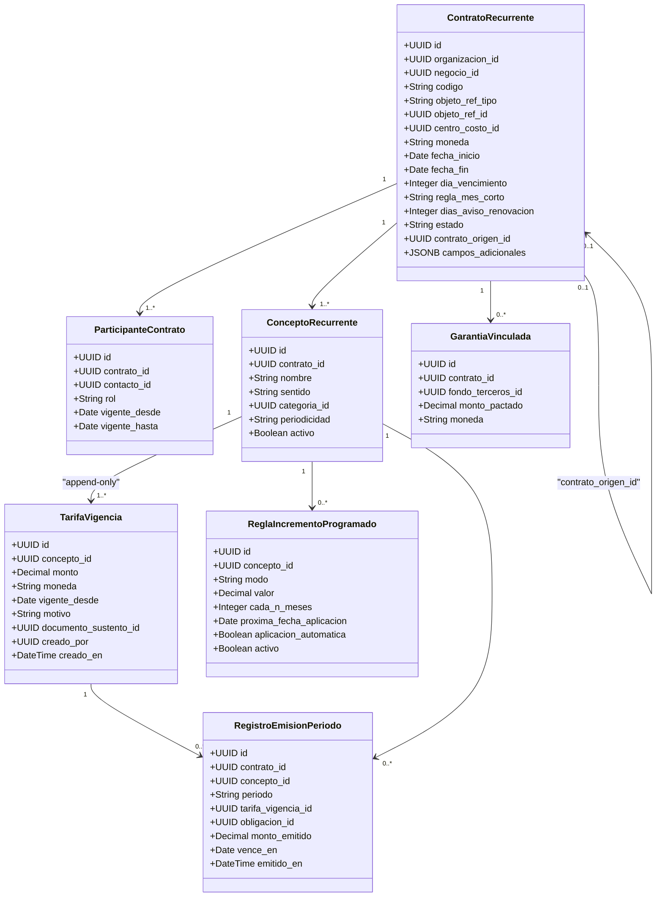
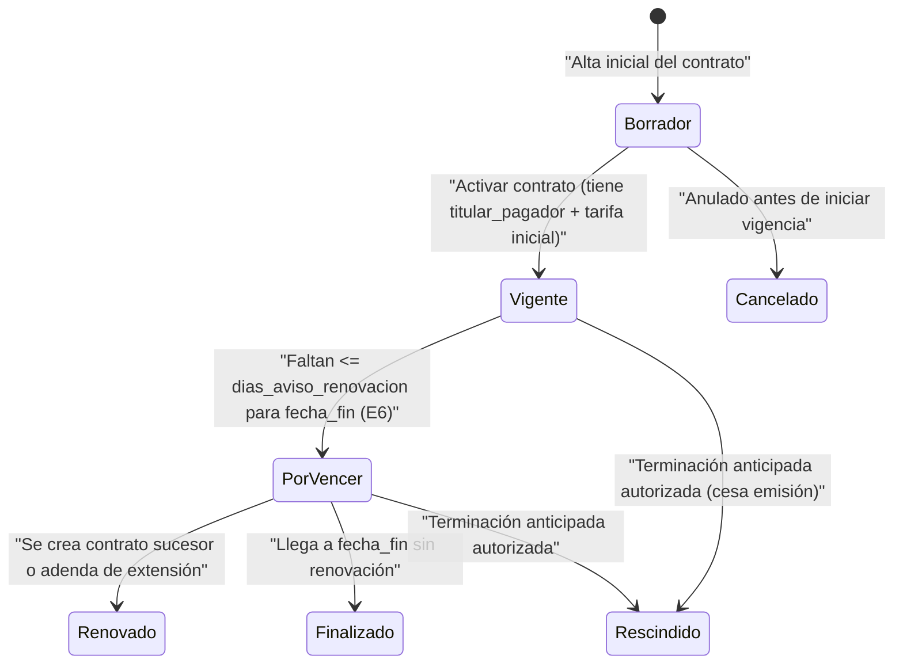
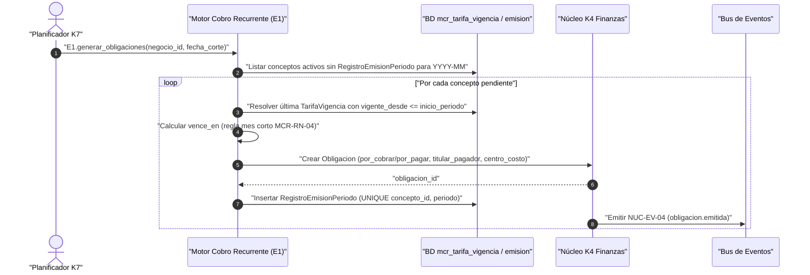

# Especificación de Requerimientos v1.0 — Motor de Contratos y Cobro Recurrente (`MCR`)

| Atributo | Valor |
|----------|-------|
| **Código de documento** | `SRS-MCR-01` |
| **Versión** | `1.0` |
| **Fecha** | 2026-11-25 |
| **Issue asociada** | `FIN-04` (`FIN-4`) |
| **Capa arquitectónica** | **Capa 2 — Motor Transversal Reutilizable (`motores/cobro-recurrente`)** |
| **Dependencias** | **Capa 1 (`NUC`)**: `K1`, `K3`, `K4`, `K5`, `K7`, `K9` ([SRS del Núcleo](./01-srs-nucleo-saas.md)) — *cero dependencias hacia paquetes de clúster* |
| **Consumidores previstos** | Clúster 1 (alquileres `1.1`–`1.4`), Clúster 3 (igualas), Clúster 4 (membresías/pensiones), Clúster 5 (abonos/mantenimiento) |

---

## 1. Introducción y Alcance del Motor

### 1.1 Propósito

Este documento especifica el **Motor de Contratos y Cobro Recurrente (`MCR`)**, componente de **Capa 2** encargado de modelar acuerdos periódicos de duración acotada o continua, custodiar su **historial tarifario inmutable con fecha de vigencia** (`NUC-RN-01`, `NUC-RN-02`), programar incrementos futuros y emitir automáticamente las `Obligacion`es periódicas hacia `K4 Finanzas` mediante los puntos de extensión del núcleo (`E1`, `E3`, `E5`, `E6`).

### 1.2 Por qué vive en Capa 2 y no en Capa 1

El principio de capas ([02-dominio-nucleo.md](../01-analisis-negocio/02-dominio-nucleo.md)) separa el **Núcleo** (Capa 1, activo para todos) de los **Motores** (Capa 2, activables por clúster):

| Criterio | Pertenece al Núcleo (`K4`) | Pertenece a este Motor (`MCR`) | Pertenece al Paquete de Clúster (ej. `C1`) |
|----------|----------------------------|--------------------------------|--------------------------------------------|
| Qué representa | La `Obligacion` ya devengada, el `Pago`, el `ComprobantePago`, el `Movimiento` y el `Periodo` | El contrato/acuerdo recurrente, sus participantes, tarifas históricas inmutables, incrementos programados y generación de cuotas fijas periódicas | Disponibilidad física de departamentos/cocheras, submedidores, prorrateo variable de agua/luz, inventario de entrega o limpieza |
| Quién lo usa | Los 6 clústeres (`C1`–`C6`) | Clústeres con facturación periódica pactada (`C1`, `C3`, `C4`, `C5`); opcional/inactivo en `C2` y `C6` | Exclusivamente negocios del clúster respectivo |

### 1.3 Frontera de responsabilidad

- **`MCR` es responsable de:**
  1. Mantener el contrato recurrente y sus participantes (distinguiendo al `titular_pagador` de co-ocupantes o garantes).
  2. Almacenar los conceptos recurrentes y sus tramos de tarifa histórica con `vigente_desde` **strictly append-only** (`NUC-RN-01`).
  3. Calcular qué tarifa rige exactamente en cada período (`NUC-RN-02`) y cuál es la fecha de vencimiento exacta en meses cortos (`MCR-RN-04`).
  4. Generar de manera **idempotente** las `Obligacion`es del período vía extensión `E1`.
  5. Evaluar contratos próximos a vencer (`E6`) para emitir alertas preventivas de renovación en `K7`.
- **`MCR` NO es responsable de:**
  - Registrar vouchers ni verificar pagos (lo hace `K4 Finanzas`).
  - Calcular prorrateos variables por consumo de submedidores ni gestionar disponibilidad física de activos (lo hace el paquete `c1-activos`, que también implementa su propio generador `E1` para conceptos variables).

---

## 2. Modelo de Dominio del Motor (`mcr_`)

Todas las entidades llevan `organizacion_id NOT NULL` (protegido por PostgreSQL `FORCE RLS`) y `negocio_id NOT NULL`, con prefijo físico de tabla `mcr_`.



### Diccionario breve de entidades clave

- **`ContratoRecurrente`:** Referencia opcionalmente al objeto contratado mediante `RefRegistro` (`objeto_ref_tipo` + `objeto_ref_id`, ej. `c1.unidad`), imputando las obligaciones al `centro_costo_id` correspondiente.
- **`ParticipanteContrato`:** Permite registrar al `titular_pagador` (destinatario fiscal/operativo de cada `Obligacion` en `K4`, obligatorio exactamente 1 vigente por contrato) junto con `co_ocupante`s o `fiador_garante`s.
- **`ConceptoRecurrente`:** Cada rubro periódico pactado en el contrato (ej. `"Alquiler mensual"`, `"Mantenimiento fijo de áreas comunes"`, `"Iguala mensual"`, `"Pensión académica"`).
- **`TarifaVigencia`:** Registro estrictamente de **solo inserción**. Representa el monto vigente a partir de `vigente_desde`. **Nunca tiene operación de edición de monto ni borrado.**
- **`RegistroEmisionPeriodo`:** Tabla de auditoría e idempotencia con restricción única `UNIQUE (concepto_id, periodo)` que enlaza cada período emitido (`YYYY-MM`) con el snapshot exacto de `tarifa_vigencia_id` y la `obligacion_id` creada en `K4`.

---

## 3. Ciclo de Vida, Vigencia Histórica Inmutable y Reglas de Cálculo

### 3.1 Ciclo de vida de `ContratoRecurrente`



| Estado | Emite obligaciones en `E1` | Permite añadir `TarifaVigencia` futura | Quién puede transicionar |
|--------|:--------------------------:|:--------------------------------------:|--------------------------|
| `Borrador` | No | Sí (ajuste antes de activar) | Dueño / Analista autorizado |
| `Vigente` | Sí | Sí (`vigente_desde >=` período abierto futuro) | Dueño / Analista (rescisión restringida a Dueño o permiso explícito) |
| `PorVencer` | Sí | Sí | Planificador (`E6`) entra aquí; Dueño / Analista renuevan |
| `Renovado` | No (emite el contrato sucesor) | No | Estado terminal de solo lectura histórica |
| `Finalizado` | No | No | Estado terminal de solo lectura histórica |
| `Rescindido` | No | No | Estado terminal de solo lectura histórica |
| `Cancelado` | No | No | Estado terminal (solo desde `Borrador` sin obligaciones) |

### 3.2 Especificación formal de Vigencia Histórica Inmutable (`NUC-RN-01`, `NUC-RN-02`)

1. **Inmutabilidad absoluta de `TarifaVigencia`:** una vez insertada una fila en `mcr_tarifa_vigencia`, **está prohibido modificar** (`UPDATE`) sus campos `monto`, `moneda`, `vigente_desde`, `concepto_id` o `motivo`, así como **eliminarla** (`DELETE`). Si hubo error de digitación antes de emitir obligaciones en el período afectado, se registra un nuevo tramo compensatorio documentado antes de activar o se anula el contrato en `Borrador`.
2. **Función determinista de resolución de tarifa:** Dado un `concepto_id` y un período `P` con fecha de inicio `inicio_P` (ej. `2026-11-01`), la tarifa aplicable es la única fila de `mcr_tarifa_vigencia` del concepto que maximiza `vigente_desde` cumpliendo:
   $$\text{vigente\_desde} \le \text{inicio\_P}$$
3. **Preservación de la historia ante consultas retroactivas:** Ningún incremento programado ni renovación futura altera el atributo `monto_emitido` ni la `tarifa_vigencia_id` de períodos pasados ya emitidos.

**Ejemplo ilustrativo trazable:**
- Contrato firmado el `2026-01-01` por alquiler mensual de `S/ 1,500.00` (`TarifaVigencia #1`, `vigente_desde = 2026-01-01`).
- En noviembre de 2026 se pacta incremento anual a `S/ 1,600.00` a partir de enero 2027: se **inserta** `TarifaVigencia #2` (`monto = 1,600.00`, `vigente_desde = 2027-01-01`).
- **Resultado:**
  - Enero a diciembre 2026 mantienen `TarifaVigencia #1 = S/ 1,500.00` tanto en cuotas emitidas como al consultar su línea de tiempo histórica.
  - La columna *"Incremento programado"* de la vista tipo tabla (`C1-RF-56`) muestra el próximo tramo (`S/ 1,600.00` desde `2027-01-01`).
  - El 1 de enero de 2027, el planificador (`E1`) resuelve `TarifaVigencia #2` y genera automáticamente la obligación de `2027-01` por `S/ 1,600.00`.

### 3.3 Reglas de negocio e invariantes del motor

#### Reglas del motor (`MCR-RN`)

| ID | Regla | Relación |
|----|-------|----------|
| **`MCR-RN-01`** | Un contrato en estado `Vigente` o `PorVencer` debe tener exactamente **un** `ParticipanteContrato` activo con rol `titular_pagador`. | `C1-RF-24` |
| **`MCR-RN-02`** | Todo cambio de tarifa se implementa insertando una nueva fila en `TarifaVigencia` con `vigente_desde`; jamás sobrescribiendo la tarifa anterior. | `NUC-RN-01` |
| **`MCR-RN-03`** | Para emitir o consultar la tarifa de un período `P`, rige la última `TarifaVigencia` con `vigente_desde <= inicio_P`. | `NUC-RN-02` |
| **`MCR-RN-04`** | **Ajuste de mes corto (`C1-Q-28`):** cuando `dia_vencimiento` excede el último día calendario del mes del período emitido (ej. día `30` o `31` en febrero o día `31` en abril), `vence_en` se fija automáticamente en el último día válido de dicho mes (ej. `28/02` o `29/02` en bisiesto). | `C1-Q-28` |
| **`MCR-RN-05`** | La emisión automática por `E1` nunca retrocede a períodos `Cerrado`s en `K4` y no duplica emisiones ya registradas para `(concepto_id, periodo)`. | `NUC-I-05` |
| **`MCR-RN-06`** | Si un contrato cambia a `Rescindido` o `Finalizado`, cesa inmediatamente toda emisión de períodos posteriores a la fecha efectiva de cierre; las obligaciones ya devengadas mantienen su exigibilidad en `K4` salvo anulación expresa. | `K4` |
| **`MCR-RN-07`** | Una renovación preserva el vínculo `contrato_origen_id` y no altera las tarifas ni obligaciones del contrato precedente. | `NUC-RN-01` |
| **`MCR-RN-08`** | En la consulta de línea de tiempo por contrato (`MCR-RF-10`), si el usuario carece de `finanzas.ver_totales`, se muestran los montos unitarios por cuota pero **se prohíbe mostrar sumatorias acumuladas** del contrato o de varios contratos. | `NUC-RN-30` |

#### Invariantes del motor (`MCR-I`)

| ID | Invariante | Garantía |
|----|------------|----------|
| **`MCR-I-01`** | No existen dos filas `TarifaVigencia` con el mismo `(concepto_id, vigente_desde)`. | Constraint `UNIQUE (concepto_id, vigente_desde)` en PostgreSQL. |
| **`MCR-I-02`** | Toda fila de `TarifaVigencia` es inmutable en `monto`, `moneda` y `vigente_desde` tras su inserción. | Trigger SQL impidiendo `UPDATE`/`DELETE` sobre campos históricos. |
| **`MCR-I-03`** | Como máximo se emite una `Obligacion` automática por `(concepto_id, periodo)`. | Constraint `UNIQUE (concepto_id, periodo)` en `mcr_registro_emision_periodo`. |
| **`MCR-I-04`** | `tarifa_vigencia.monto > 0` y almacenado en `NUMERIC(14,2)` sin coma flotante. | `CHECK (monto > 0)` + `NUC-I-14`. |
| **`MCR-I-05`** | Un contrato activo siempre posee `fecha_inicio <= fecha_fin` (cuando `fecha_fin IS NOT NULL`). | `CHECK` + validación en servicio. |
| **`MCR-I-06`** | Aislamiento estricto: toda entidad `mcr_*` pertenece a una única `organizacion_id` bajo PostgreSQL `FORCE RLS`. | Herencia de `NUC-I-01`. |

---

## 4. Requerimientos Funcionales del Motor (`MCR-RF-01` a `MCR-RF-10`)

```text
ID:            MCR-RF-01
Nombre:        Registro y activación de contrato recurrente y participantes
Prioridad:     M          Etapa: 1
Origen:        Generalización de C1-RF-24, C1-RF-60
Actores:       Dueño, Analista (según permiso del paquete)
Precondición:  Motor `cobro-recurrente` activado en el negocio; contacto titular existente en K3.
Descripción:   Permitir crear un contrato en estado `Borrador` vinculándolo opcionalmente a un registro
               de paquete vía `RefRegistro` (`objeto_ref_tipo`, `objeto_ref_id`) y `CentroCosto`,
               definiendo moneda, fechas de vigencia, día de vencimiento (1..31), días de preaviso
               de renovación, garantía vinculada opcional y participantes (1 `titular_pagador` más N
               co-ocupantes o garantes). Al activar, valida reglas y pasa a `Vigente`.
Reglas:        MCR-RN-01, NUC-RN-20, NUC-RN-21
Invariantes:   MCR-I-05, MCR-I-06
Criterio de aceptación:
  Dado un contrato con titular pagador asignado, `fecha_inicio = 2026-03-01`, `fecha_fin = 2027-02-28`
  y al menos un concepto con tarifa > 0,
  cuando se activa el contrato,
  entonces pasa a estado `Vigente` y queda elegible para el generador `E1`.
```

```text
ID:            MCR-RF-02
Nombre:        Definición de conceptos recurrentes periódicos y tarifa inicial
Prioridad:     M          Etapa: 1
Origen:        Generalización de C1-RF-24, C1-RF-26
Actores:       Dueño, Analista autorizado
Precondición:  Contrato existente en el negocio actual.
Descripción:   Permitir asociar uno o más `ConceptoRecurrente` por contrato (ej. alquiler, cochera,
               pensión, iguala), especificando sentido (`por_cobrar` | `por_pagar`), categoría en K4,
               periodicidad (`mensual`, `bimestral`, `trimestral`, `semestral`, `anual`) y su primera
               fila inmutable en `TarifaVigencia` con `vigente_desde = contrato.fecha_inicio`.
Reglas:        NUC-RN-01, MCR-RN-02
Invariantes:   MCR-I-01, MCR-I-02, MCR-I-04
Criterio de aceptación:
  Dado un contrato nuevo con alquiler de `S/ 1,400.00` y mantenimiento fijo de `S/ 120.00`,
  cuando se guardan ambos conceptos,
  entonces cada uno registra exactamente una fila inicial en `TarifaVigencia` con `vigente_desde` igual al inicio del contrato.
```

```text
ID:            MCR-RF-03
Nombre:        Actualización tarifaria mediante nueva vigencia histórica inmutable
Prioridad:     M          Etapa: 1
Origen:        Generalización de C1-RF-26, NUC-RN-01, NUC-RN-02
Actores:       Dueño, Analista autorizado
Precondición:  Contrato `Vigente` o `PorVencer`.
Descripción:   Cuando cambie el importe pactado de un concepto (por adenda o ajuste manual), el sistema
               debe insertar un nuevo registro `TarifaVigencia` con el nuevo monto, moneda, `vigente_desde`,
               motivo y documento de sustento opcional en K5, manteniendo intactos todos los tramos
               históricos y las obligaciones ya emitidas.
Reglas:        NUC-RN-01, NUC-RN-02, MCR-RN-02, MCR-RN-03
Invariantes:   MCR-I-01, MCR-I-02, MCR-I-04
Criterio de aceptación:
  Dado un contrato con tarifa vigente `S/ 1,500.00` desde `2026-01-01` cuyas cuotas ene–dic 2026 ya existen,
  cuando se registra un nuevo tramo de `S/ 1,650.00` con `vigente_desde = 2027-01-01`,
  entonces los montos históricos de 2026 siguen consultándose en `S/ 1,500.00` y las emisiones desde `2027-01` nacen en `S/ 1,650.00`.
```

```text
ID:            MCR-RF-04
Nombre:        Programación de incrementos periódicos futuros
Prioridad:     S          Etapa: 1–2 (visible en columna incremento C1-RF-56 desde E1; automatización configurable en E2)
Origen:        Generalización de C1-RF-27, C1-RF-56
Actores:       Dueño, Analista autorizado, Planificador
Precondición:  Concepto recurrente activo.
Descripción:   Permitir definir una `ReglaIncrementoProgramado` (porcentaje, monto fijo o índice) con
               periodicidad (ej. cada 12 meses) y próxima fecha de aplicación, exponiendo el próximo
               incremento programado en las vistas tabulares y permitiendo generar automáticamente la nueva
               `TarifaVigencia` (si `aplicacion_automatica = true`) o disparar alerta previa de confirmación.
Reglas:        NUC-RN-01, NUC-RN-02, MCR-RN-02
Invariantes:   MCR-I-01, MCR-I-02, MCR-I-04
Criterio de aceptación:
  Dado un contrato con alquiler `S/ 1,000.00` e incremento programado de `+5 %` para `2027-03-01` en modo alerta,
  cuando se consulta la vista tabular de contratos en `2026-11`,
  entonces aparece visible el incremento futuro y al llegar la fecha configurada se notifica o aplica insertando `TarifaVigencia` por `S/ 1,050.00`.
```

```text
ID:            MCR-RF-05
Nombre:        Generación programada e idempotente de obligaciones recurrentes (`E1`)
Prioridad:     M          Etapa: 1
Origen:        Generalización de C1-RF-25, E1
Actores:       Planificador diario (`K7`), Dueño (ejecución manual de respaldo en período abierto)
Precondición:  Negocio `Activo`; período destino `Abierto` en `K4`; contratos `Vigente` o `PorVencer`.
Descripción:   Durante la ronda diaria (`NUC-CU-20`) o disparo manual controlado, el motor evalúa cada
               `ConceptoRecurrente` activo cuyo período actual aún no tenga fila en `RegistroEmisionPeriodo`,
               resuelve la tarifa vigente según `MCR-RN-03`, calcula fecha de vencimiento (`MCR-RF-06`),
               solicita a `K4` la creación de `Obligacion` a nombre del `titular_pagador` y guarda la
               constancia de emisión para garantizar idempotencia.
Reglas:        NUC-RN-02, MCR-RN-01, MCR-RN-03, MCR-RN-05
Invariantes:   MCR-I-03, MCR-I-04, NUC-I-05
Criterio de aceptación:
  Dada una organización con 11 contratos vigentes el 01 del mes,
  cuando el planificador diario se ejecuta dos veces consecutivas en esa fecha,
  entonces emite exactamente 11 obligaciones en `K4` durante la primera corrida y 0 duplicados en la segunda.
```

```text
ID:            MCR-RF-06
Nombre:        Cálculo determinista de fechas de vencimiento y regla de mes corto
Prioridad:     M          Etapa: 1
Origen:        C1-Q-28, C1-RF-71
Actores:       Planificador / Servicio de dominio
Precondición:  Contrato con `dia_vencimiento` configurado (`1..31`).
Descripción:   Calcular la fecha exacta `vence_en` de cada obligación periódica dentro del mes del período.
               Si `dia_vencimiento` es mayor al último día del mes calendario objetivo (ej. día `30` o `31`
               en febrero, o `31` en abril/junio/septiembre/noviembre), ajustar automáticamente al último
               día válido de ese mes sin desbordar hacia el mes siguiente.
Reglas:        MCR-RN-04
Invariantes:   MCR-I-03
Criterio de aceptación:
  Dado un contrato con "pago el día 30 de cada mes" (`dia_vencimiento = 30`),
  cuando se generan las obligaciones de febrero 2026 (no bisiesto) y febrero 2028 (bisiesto),
  entonces `vence_en` se calcula como `2026-02-28` y `2028-02-29` respectivamente.
```

```text
ID:            MCR-RF-07
Nombre:        Detección de contratos próximos a vencer y alertas de renovación (`E6`)
Prioridad:     M          Etapa: 1–2
Origen:        NUC-P-14, C1-RF-34
Actores:       Planificador (`E6`), Dueño, Analista
Precondición:  Contrato `Vigente` con `fecha_fin` no nula y `dias_aviso_renovacion > 0`.
Descripción:   Mediante trabajo diario registrado en `E6`, identificar contratos cuya diferencia
               `(fecha_fin - hoy) <= dias_aviso_renovacion` (ej. 30 a 60 días configurables),
               transicionar el contrato a estado `PorVencer` y emitir alerta en `K7` para gestionar
               su renovación con anticipación.
Reglas:        NUC-RN-25
Invariantes:   MCR-I-05, MCR-I-06
Criterio de aceptación:
  Dado un contrato con `fecha_fin = 2026-12-31` y `dias_aviso_renovacion = 30`,
  cuando llega la ronda diaria del `2026-12-01`,
  entonces el contrato pasa a `PorVencer` y se genera una única alerta de renovación en bandeja y correo.
```

```text
ID:            MCR-RF-08
Nombre:        Renovación de contrato preservando trazabilidad histórica
Prioridad:     M          Etapa: 1–2
Origen:        MCR-RN-07, C1-RF-24, C1-RF-34
Actores:       Dueño, Analista autorizado
Precondición:  Contrato en estado `Vigente` o `PorVencer`.
Descripción:   Permitir renovar un contrato generando un contrato sucesor con `contrato_origen_id`
               apuntando al contrato previo (o cerrando el anterior en `Renovado` al iniciar la nueva
               vigencia), heredando participantes, `RefRegistro` y conceptos ajustables, sin alterar
               las tarifas ni registros del contrato anterior.
Reglas:        NUC-RN-01, MCR-RN-07
Invariantes:   MCR-I-02, MCR-I-05, MCR-I-06
Criterio de aceptación:
  Dado el Contrato A que vence el `2026-12-31`,
  cuando se aprueba su renovación en Contrato B desde `2027-01-01` con nuevo canon de `S/ 1,700.00`,
  entonces Contrato A queda en `Renovado` conservando sus tarifas anteriores y Contrato B inicia en `Vigente` enlazado por `contrato_origen_id`.
```

```text
ID:            MCR-RF-09
Nombre:        Finalización natural o rescisión anticipada del contrato
Prioridad:     M          Etapa: 1–2
Origen:        MCR-RN-06, NUC-RF-39
Actores:       Dueño (rescisión) / Planificador (finalización automática por fecha_fin)
Precondición:  Contrato en estado `Vigente` o `PorVencer`.
Descripción:   Marcar el contrato como `Finalizado` al vencer `fecha_fin` sin renovación, o como
               `Rescindido` con motivo y fecha efectiva cuando termina anticipadamente, deteniendo de
               inmediato emisiones futuras en `E1` y enlazando a `K4` para liquidación o devolución de
               `FondoTerceros` vinculados (`GarantiaVinculada`).
Reglas:        MCR-RN-06, NUC-RN-22, NUC-RN-27
Invariantes:   MCR-I-02, MCR-I-06
Criterio de aceptación:
  Dado un contrato rescindido con fecha efectiva `2026-08-31`,
  cuando corre la generación automática del período `2026-09`,
  entonces el generador omite dicho contrato sin emitir nuevas cuotas y audita la rescisión.
```

```text
ID:            MCR-RF-10
Nombre:        Línea de tiempo auditable de tarifas y vista tabular de obligaciones por contrato
Prioridad:     S          Etapa: 1–2
Origen:        C1-RF-35, C1-RF-56, NUC-RN-30
Actores:       Dueño, Analista (sin totales)
Precondición:  Permiso de lectura operativa en el negocio.
Descripción:   Exponer una vista estructurada y filtrable por contrato (tipo tabla cronológica que
               reemplaza las columnas por mes de las hojas de cálculo) mostrando el historial completo
               de tramos `TarifaVigencia`, incrementos programados futuros y el estado actualizado de
               cada `Obligacion` emitida en `K4`, ocultando sumatorias y totales para roles sin `finanzas.ver_totales`.
Reglas:        NUC-RN-01, NUC-RN-12, NUC-RN-30, MCR-RN-08
Invariantes:   MCR-I-06
Criterio de aceptación:
  Dado un Analista sin permiso `finanzas.ver_totales` consultando la tabla de cuotas del Contrato 101,
  cuando visualiza los 12 períodos del año e incremento futuro,
  entonces observa cada monto individual, estado y fecha de pago, sin ninguna fila o columna de suma total.
```

---

## 5. Integración con el Núcleo y Trazabilidad hacia Clústeres

### 5.1 Contratos del Núcleo implementados por `MCR`

| Punto de extensión / Declaración | Implementación de `motores/cobro-recurrente` |
|----------------------------------|----------------------------------------------|
| **`D1` Tipos de registro** | Declara `mcr.contrato` como tipo válido en `RefRegistro` (para adjuntar contratos PDF en `K5`, tareas en `K6` o mensajes). |
| **`D2` Permisos** | Declara `mcr.gestionar_contratos`, `mcr.modificar_tarifa`, `mcr.rescindir_contrato`. |
| **`E1` Generador de obligaciones** | Registra `mcr.emision_periodica`: evalúa contratos `Vigente`/`PorVencer` del negocio y emite obligaciones en `K4` respetando idempotencia por `(concepto_id, periodo)`. |
| **`E3` Condición de cierre** | Registra `mcr.cuotas_del_periodo_emitidas`: verifica antes de cerrar un mes que ningún contrato vigente del período falte de emitir en `RegistroEmisionPeriodo`. |
| **`E5` Suscripción a eventos** | Escucha `obligacion.pagada` / `pago.verificado` únicamente para refrescar vistas operativas sin acoplarse a tesorería, y `negocio.desactivado` para detener emisiones futuras. |
| **`E6` Trabajos programados** | Registra `mcr.evaluar_contratos_por_vencer` y `mcr.evaluar_incrementos_programados` para la ronda diaria de `K7`. |

### 5.2 Secuencia de emisión periódica idempotente (`E1` + `K7` + `K4`)



### 5.3 Trazabilidad hacia requerimientos de Clúster 1 (`FIN-05`)

Los siguientes requerimientos preliminares de Clúster 1 ([06-requerimientos-preliminares.md](../../clusters/cluster-1-activos-alquileres-espacios/01-analisis-negocio/06-requerimientos-preliminares.md)) **no deben reescribirse desde cero** en el futuro SRS de Clúster 1; dicho SRS los implementará **consumiendo directamente este motor**:

| Requerimiento de `C1` | Requerimiento de `MCR` que lo satisface | Qué agrega únicamente el paquete `C1` en `FIN-05` |
|-----------------------|-----------------------------------------|--------------------------------------------------|
| `C1-RF-24` (Contratos inquilino-unidad) | `MCR-RF-01`, `MCR-RF-02` | Valida que la unidad (`c1.unidad`) no esté ocupada por otro contrato vigente en fechas solapadas y vincula el estado de ocupación del inmueble. |
| `C1-RF-25` (Cuotas mensuales automáticas) | `MCR-RF-05`, `MCR-RF-06` | Ninguna lógica adicional para renta fija; para servicios variables agrega su propio generador `c1.prorrateo_servicios`. |
| `C1-RF-26` (Historial inmutable de montos) | `MCR-RF-03`, `MCR-I-01`, `MCR-I-02` | Satisfecho íntegramente por `MCR`. |
| `C1-RF-27` (Incrementos programados) | `MCR-RF-04` | Apoyo visual de "alquiler sugerido" desde estudio de mercado por m² (`C1-RF-66`). |
| `C1-RF-34` (Alerta de renovación) | `MCR-RF-07`, `MCR-RF-08` | Parámetro por defecto de días de aviso en plantilla `1.1-inmobiliaria`. |
| `C1-RF-56` (Vista tipo tabla cronológica) | `MCR-RF-10`, `NUC-RN-30` | Etiquetas inmobiliarias (`Inquilino`, `Unidad`, `Cuota`) vía plantilla `D3`. |
